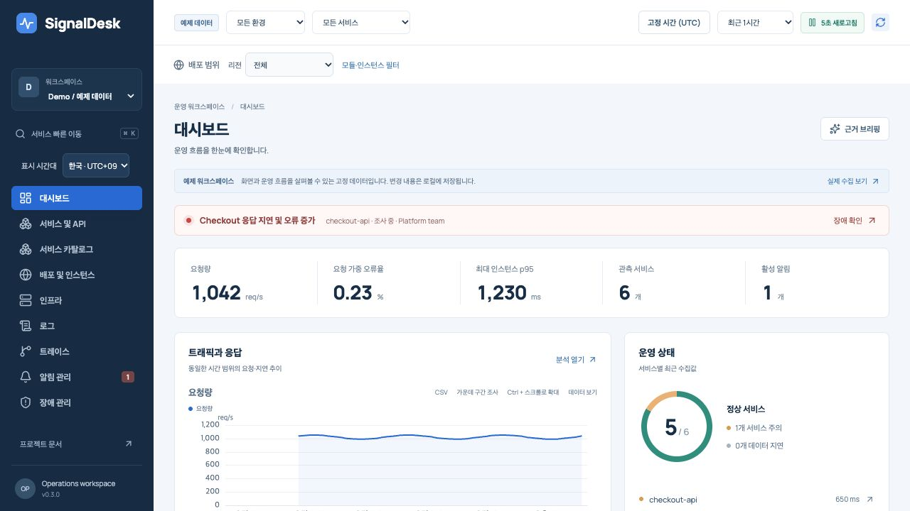

# SignalDesk

서버·API의 상태에서 로그, 트레이스, 알림, 장애 대응까지 연결하는 운영 모니터링 플랫폼입니다. **v0.3는 서비스 소유권, 전 기간 서버 집계, SLO, 전달 정책, AI 버전 평가까지 연결합니다.** 여러 리전·모듈·인스턴스와 공유 PostgreSQL 기반 API·작업자 실행을 지원합니다. 한국어 UI, ECharts 시각화, 실제 수집·조회 API를 포함합니다.



## 실행

Node.js 24 이상이 필요합니다.

```bash
npm ci
npm run build
npm start
```

http://127.0.0.1:4319에서 확인하세요. Demo는 3개 리전과 36개 서비스 인스턴스, 9개 호스트를 포함한 예제입니다. Live는 실제 수집 데이터이며 기본 로컬 실행에서는 호스트 CPU·메모리와 플랫폼 API 트레이스를 수집합니다. 기존 서버에는 수집기를 연결해야 합니다.

## 여러 API·작업자 실행

```bash
npm run --silent credentials > .env
docker compose --env-file .env -f deploy/compose.distributed.yaml up --build -d
```

http://127.0.0.1:4321에서 `.env`의 admin 토큰으로 연결하세요. PostgreSQL, API 2개, 작업자 2개, 로드밸런서를 실행합니다. `.env`에는 접근 토큰·암호화 키·DB 비밀번호가 있으므로 커밋하지 마세요. 기존 파일을 교체하면 키도 바뀌므로 새 설치에서 생성하세요.


## 포함한 기능

| 화면                | 동작                                                                     |
| ------------------- | ------------------------------------------------------------------------ |
| 대시보드            | 환경·서비스·시간·배포 범위, 요청량·오류율·지연, 장애 맥락                |
| 배포 및 인스턴스    | 리전 비교, 모듈·클러스터·네임스페이스·인스턴스 필터, 관측 제외/재개      |
| 서비스·API / 인프라 | RED 지표, 개별 인스턴스 신선도, 호스트 CPU·메모리                        |
| 로그 / 트레이스     | 가상 로그 목록, 안정적인 페이지 탐색, 리전 간 요청 워터폴                |
| 알림 / 장애         | 인스턴스·리전·서비스별 규칙, 지속 시간·데이터 없음, 확인·중지, 조사 메모 |
| 알림 전달           | 암호화 Webhook 주소, 영속 outbox, 재시도와 전달 이력                     |
| 분석 / AI 워크로드  | 오류 그룹·히트맵, 모델·토큰·지연·출처가 있는 비용·평가                   |
| 연결·설정           | API 검사, 저장 용량, 작업자별 하트비트, 변경 이력                        |

서비스 카탈로그에서 팀·저장소·runbook·리전을 관리하고, SLO에서 성공률·지연·오류 예산·burn rate를 같은 서버 집계로 평가합니다. 전달 정책은 담당 팀·서비스·환경·리전·심각도를 매칭하고 유지보수·반복·복구 알림을 관리합니다.

그래프는 ECharts 6.1의 확대·시리즈 선택·숫자 표·CSV를 제공하고 로그는 TanStack Virtual을 사용합니다. 절대 시간·KST/UTC·저장된 조사·URL 상세 복원을 지원합니다. 화면 이동 시 배포 범위를 유지하며, 정확한 트레이스를 열면 요청에 참여한 다른 리전의 스팬도 함께 보여줍니다.

## 확장성과 장애 처리

리소스는 `service + environment + module + region + zone + cluster + namespace + instanceId`로 구분합니다. 같은 Pod 이름도 리전·모듈이 다르면 별도입니다. 요청량은 합산하고 오류율은 요청량으로 가중합니다. p95는 인스턴스별 최대값이며 전체 요청의 p95로 표시하지 않습니다.

PostgreSQL의 공유 상태와 작업별 세션 잠금으로 여러 작업자의 중복 실행을 제어합니다. 알림과 전달 작업은 같은 트랜잭션으로 발행하고 동시 장애 메모도 보존합니다. 리전 Collector는 트레이스 디스크 큐를 사용합니다. 기본 SDK는 메모리 큐이며 Node용 `DurableSignalDeskClient`는 파일 큐를 fsync하고 재시작 뒤 같은 ID로 재전송합니다. 큐 경로당 한 생산자만 사용합니다.

**검증 범위:** 실제 컨테이너 API 2개·작업자 2개, 중복 수집, 동시 메모, 작업자 종료 후 처리, API 재시작, 수집기 연결 장애·재시작 후 트레이스 복구를 검증했습니다. 이 실험은 한 호스트에서 리전 식별자를 나눈 것입니다. 실제 지리적 장애·관리형 PostgreSQL 전환·운영 트래픽 부하 인증은 완료하지 않았습니다. [멀티 리전 설계](docs/MULTI_REGION.md)에 배포 책임과 검증 기준을 정리했습니다.

## AI 적용

Langfuse·Opik·Phoenix·OpenTelemetry GenAI를 조사했습니다. 현재는 AI 호출 관측과 **로컬 규칙 기반 근거 브리핑**을 구현했습니다. 비용과 평가에는 출처를 요구하며 프롬프트·응답·도구 인자 본문은 수집 시 제거합니다. 버전 데이터셋·후보 응답·baseline을 비교하는 구조화 평가 runner와 실패 표본·coverage를 제공합니다. 선택한 HTTPS 분석 gateway에 집계 근거를 보내는 경로도 구현했습니다. 기본은 외부 호출 없이 로컬 분석이며, gateway 설정과 운영자의 전송 동의를 모두 요구합니다. 모델 분석 정확도와 자동 복구는 검증·구현 완료 상태가 아닙니다.

## 검증

```bash
npm run check
docker build -t signaldesk:local .
npm run test:distributed
```

기본 보존은 7일, 이벤트 상한은 100만 개, 리소스 상한은 워크스페이스별 2만 개입니다. 조회 상한·누락·지연은 화면에 표시합니다. OTLP HTTP JSON 트레이스·로그·메트릭의 제한된 부분을 지원하며 protobuf/gRPC·exponential histogram은 지원하지 않습니다. 전체 label 시계열 엔진을 대체하지 않습니다. 고용량 저장 어댑터, SSO, 자동 배포 발견은 로드맵에 구분했습니다.

2026-10-09 [오픈소스 비교 리뷰](docs/OSS_COMPARISON_REVIEW.md)에서 확인한 정확성·조사 흐름 문제 R1–R7은 v0.3에서 수정하고 회귀 검증했습니다. 추가 기능·UX 격차는 [로드맵](docs/ROADMAP.md)에 남겼습니다. CI 통과를 성숙한 운영 제품과의 동등성이나 운영 준비 완료로 해석하지 않습니다.

[전체 README](README.md) · [기획·UX](docs/PRODUCT.md) · [설계](docs/ARCHITECTURE.md) · [리서치](docs/RESEARCH.md) · [비교 리뷰](docs/OSS_COMPARISON_REVIEW.md) · [API](docs/API.md) · [운영](docs/OPERATIONS.md) · [검증 기록](docs/VERIFICATION.md)

2026-10-10 [당근·토스 운영 리서치](docs/DAANGN_TOSS_RESEARCH.md): 공식 발표 PDF 7편과 GitHub 6개 저장소를 바탕으로 서비스 오너십, 알림 조사 UX, SLI, 관측 플랫폼 확장과 AI 적용을 검토했습니다. 공개 운영 사례와 개발 예정 요구사항을 구분합니다.

MIT License. 참조 제품의 UI 코드나 이미지는 복제하지 않았습니다.

## v0.3 개발과 검증

[재설계 기록](docs/REDESIGN.md)과 [검증 기록](docs/VERIFICATION.md)에 구현과 제한을 구분했습니다. 기존 R1–R7은 수정했으며 카탈로그·SLO·전달 정책·관계·AI 평가 화면을 기능별 모듈로 나눴습니다. API·오류·AI 분석은 보존된 전체 범위를 SQL로 집계하고, 1,000개 결과 그룹 상한을 표시합니다. 호스트 그래프와 개별 호출 화면은 표본 범위입니다.

운영 파일럿으로 평가할 수 있는 단계입니다. 실제 운영 트래픽 부하, 관리형 DB 장애 전환, 외부 알림 수신과 LLM 분석 품질은 별도 운영 검증이 필요합니다. ClickHouse/Mimir 어댑터, SSO, on-call escalation, Kafka lag 수집과 자동 복구를 구현한 것으로 표현하지 않습니다.
