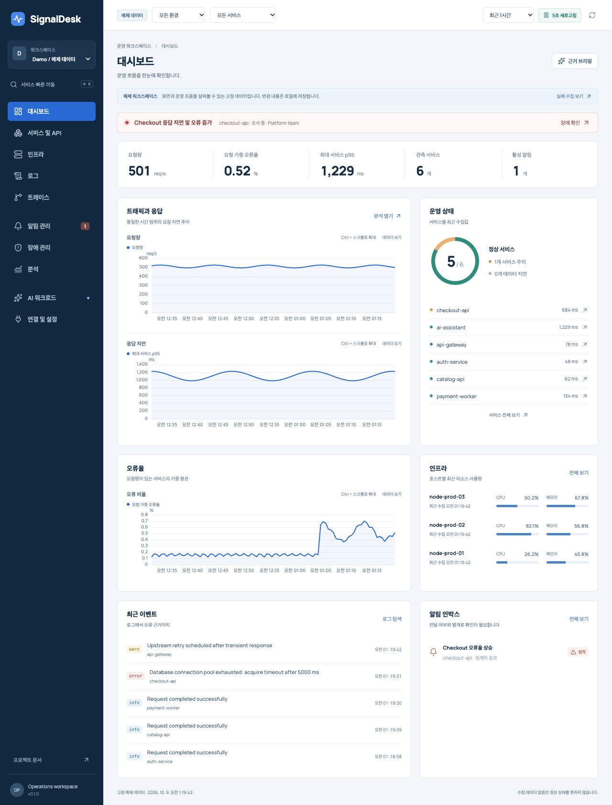
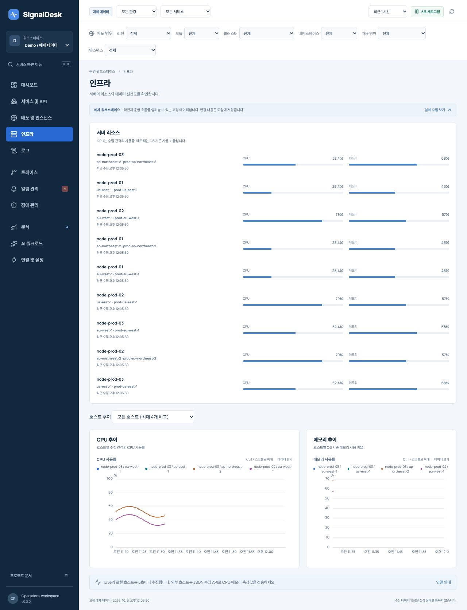
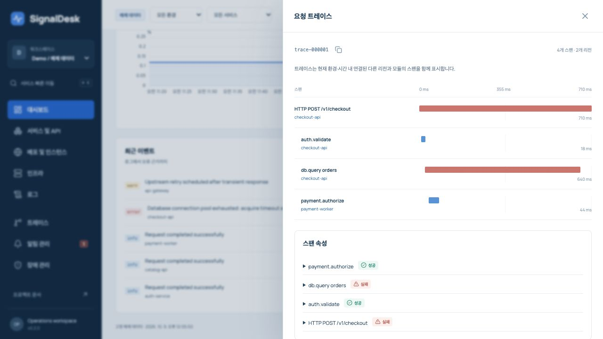
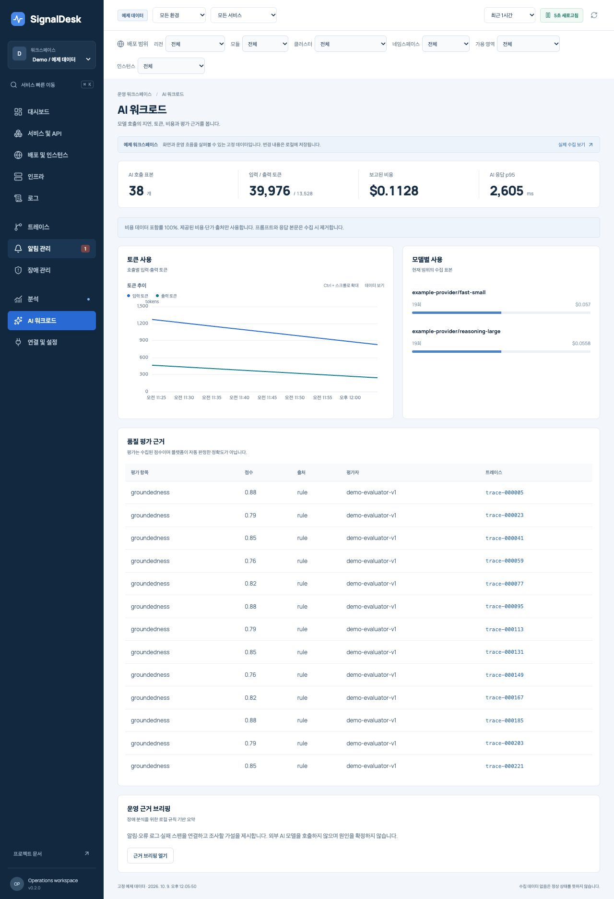
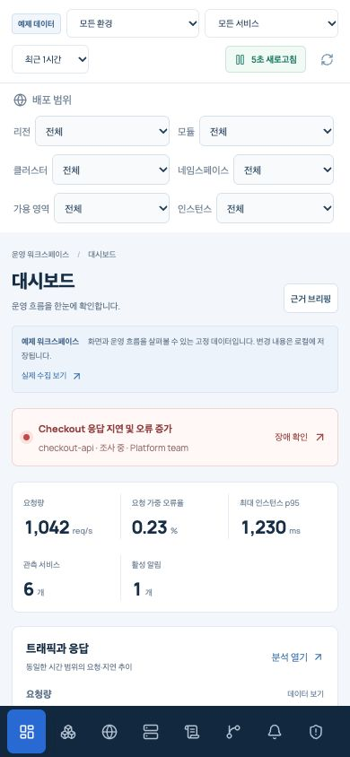
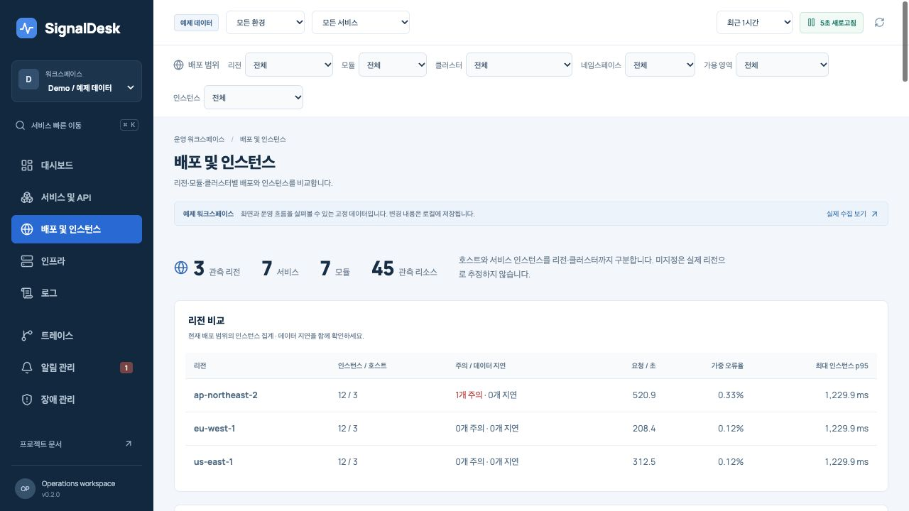
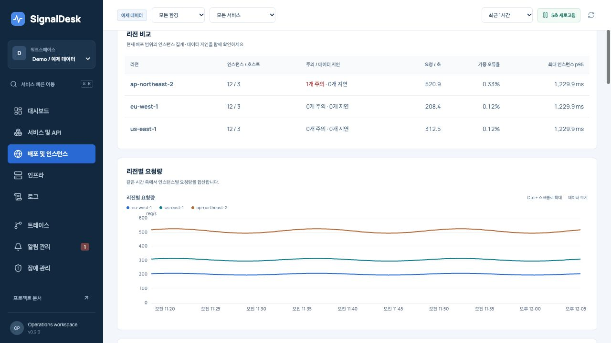
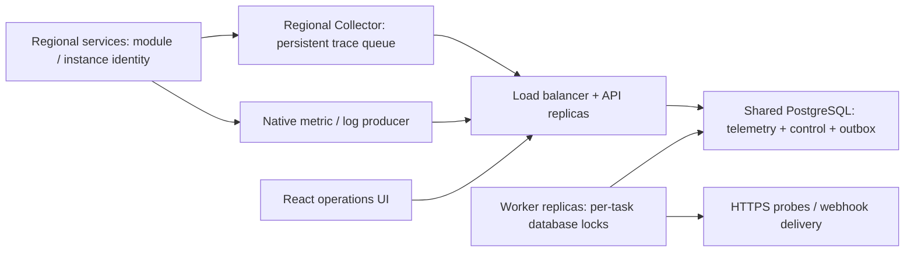

<div align="center">

# SignalDesk

**An operations workspace that connects signals to decisions.**

Servers · APIs · Logs · Traces · Alerts · Incidents · AI workloads

[](https://github.com/benny1020/signaldesk/actions/workflows/ci.yml)


[Quick start](#quick-start) · [Features](#features) · [Architecture](docs/ARCHITECTURE.md) · [Research](docs/RESEARCH.md) · [한국어](README.ko.md)

</div>



SignalDesk is a self-hosted monitoring and incident workspace for engineers who need to move from a service symptom to logs, a request trace, an alert, and an incident timeline without losing context. It pairs a dense, readable interface with a working ingestion API, persistent storage and background evaluation.

**Release status: v0.2 resource-aware, multi-process baseline.** Identify services by environment, module, region, zone, cluster, namespace and instance. Run multiple API and worker processes against shared PostgreSQL, or use SQLite for local evaluation. Demo and Live remain separate. The reference deployment and failure tests run locally; managed database failover and geographically distributed production capacity are not certified.

## Features

| Workspace       | Implemented behavior                                                                                                                                        |
| --------------- | ----------------------------------------------------------------------------------------------------------------------------------------------------------- |
| Deployments     | Regional comparison, per-resource inventory, six shared deployment filters, instance drilldown and explicit retirement/resume                               |
| Overview        | Shared environment/service/time filters, request rate, request-weighted error percentage, maximum service p95, incident context and actionable service rows |
| Services & APIs | RED measurements, freshness state, service drawer and related log/trace navigation; parent/child span-derived service connections                           |
| Infrastructure  | Real local CPU and OS memory collection every 5 seconds, timestamped host measurements; JSON ingestion for external hosts                                   |
| Logs            | Message/level search, virtualized rows, stable keyset pagination, JSON export, attributes and trace linking                                                 |
| Traces          | Indexed trace lookup, parent/child waterfall, duration, status and span attributes                                                                          |
| Alerts          | Resource/region/service rule groups, group-aware preview, independent duration/recovery/no-data, acknowledgment and snooze                                  |
| Notifications   | Encrypted HTTPS destinations, persisted outbox, bounded exponential retries, delivery history and manual failed-job retry                                   |
| Incidents       | Independent incident states, owners, linked alert and persistent investigation notes/timeline                                                               |
| Analytics       | Observed root-span success rate, normalized error groups and service/time error heatmap; sample limits are visible                                          |
| AI workloads    | Provider/model, token usage, reported cost with provenance, TTFT, AI latency and evaluation source/version; trace-linked evidence                           |
| Operations      | HTTPS synthetic checks, ingest health, bounded retention/capacity, scoped admin/viewer/ingest tokens, audit trail                                           |

Charts use modular **Apache ECharts 6.1**, with zoom, series toggles, explicit units and a numeric table alternative. Logs use **TanStack Virtual** and paged server queries. React Query coordinates polling and invalidation. Reduced motion, native modal focus handling and small-screen layouts are included.

<details>
<summary>More screens: infrastructure, cross-region trace, AI workloads and mobile</summary>






</details>

## Quick start

Requires Node.js **24 or newer** and npm.

```bash
git clone https://github.com/benny1020/signaldesk.git
cd signaldesk
npm ci
npm run build
npm start
```

Open **http://127.0.0.1:4319**. Local mode binds loopback without a token. A seeded Demo workspace lets you inspect the entire workflow. Switch to **Live** to see actual local host measurements and self-instrumented API traces. Live logs appear when you ingest logs or the API returns a server error; synthetic sample logs are never labelled live.

Send real sample events from the included producer:

```bash
node examples/send-sample.mjs
node examples/ai-span.mjs
```

These examples send explicitly named `example-*` services to Live. They do not instrument your existing servers automatically. The AI example makes no model call and reports no fabricated cost.

### Development

```bash
npm run dev
```

Web: http://127.0.0.1:5178. API: http://127.0.0.1:4319. The `.env` file is loaded by the Node entrypoint. If you change the API port, update the development proxy in `apps/web/vite.config.ts`.

### Shared PostgreSQL deployment

```bash
npm run --silent credentials > .env
docker compose --env-file .env -f deploy/compose.distributed.yaml up --build -d
```

Open **http://127.0.0.1:4321** and enter the admin token from `.env`. This starts PostgreSQL, two API replicas, two workers and a load balancer. All writers use the same database. Worker ownership uses database session locks; alert and outbox publication is transactional. These containers run on one host; their region labels demonstrate resource scoping.

For a real regional deployment, use managed PostgreSQL HA, regional Collector persistent volumes, TLS and measured connection/capacity budgets. [Multi-region design and failure behavior](docs/MULTI_REGION.md) gives the deployment boundary and acceptance gates.





### Single-process Docker evaluation

```bash
npm run --silent credentials > .env
docker compose up --build -d
```

Open **http://127.0.0.1:4320** and enter the admin token from your local `.env`. Do not commit this file. The container runs as a non-root user in token mode and stores data in a named volume. Its local host collector observes the container's OS view, not necessarily your physical host. See [operations](docs/OPERATIONS.md) for deployment, backups and recovery.

## Connect a service

The native endpoint accepts a validated, atomic batch of up to 1,000 metrics, logs or spans. IDs make retries idempotent within a workspace. Timestamps are Unix milliseconds; events must fit the seven-day retention window and be no more than 60 seconds in the future.

```js
await fetch('http://127.0.0.1:4319/api/ingest', {
  method: 'POST',
  headers: { 'content-type': 'application/json' },
  body: JSON.stringify({
    workspace: 'live',
    events: [
      {
        id: 'orders-error-rate-' + Date.now(),
        kind: 'metric',
        timestamp: Date.now(),
        service: 'orders-api',
        environment: 'production',
        module: 'api',
        region: 'ap-northeast-2',
        cluster: 'commerce-prod',
        namespace: 'orders',
        instanceId: 'orders-pod-1',
        name: 'error_pct',
        value: 0.4,
      },
    ],
  }),
});
```

In token mode include `Authorization: Bearer <ingest-token>`. Never put a token in a URL. The lightweight [producer](packages/sdk/index.js) adds stable IDs, bounded batches, timeouts, retries and queue/drop counters. It is repository source, not a published npm package. Set its `resource` defaults once and flush from the application lifecycle. Its retry queue is bounded **in memory**; it does not survive producer restarts. The supplied regional Collector configuration persists **traces** to disk and exports gzip OTLP/HTTP JSON.

[API reference](docs/API.md) includes all operations, the trace bridge, roles and examples. **`/api/v1/traces` accepts a bounded subset of OTLP/HTTP JSON traces. It does not accept protobuf, metrics, logs or gRPC.** Do not point a default protobuf OTLP exporter at it and expect full compatibility.

## Architecture and extension points



`TelemetryStore` defines resource-scoped reads, indexed latest metrics and inventory. `ControlStore` owns rules, independent group states, incidents, audit and delivery transactions. Both PostgreSQL and SQLite implement `Storage`; APIs and workers use the same contracts. Prometheus, Loki, Tempo and ClickHouse adapters remain planned.

Resource identity separates monitored deployments from platform replicas. A worker evaluates each rule group independently, publishes one active alert per group and preserves concurrent acknowledgments/incident notes. PostgreSQL session-lock loss fences the old worker's database operations. SQLite supports one combined process; a shared SQLite volume is not a replica strategy. See [architecture](docs/ARCHITECTURE.md).

## AI monitoring

AI observability and AI-assisted operations have different evidence requirements:

- **Observe AI services:** correlate model/tool spans, latency, tokens and evaluations with server/API failures. Accept costs only with an explicit producer-supplied cost source. Missing cost and evaluations remain unknown. AI message and tool argument/result attributes are removed during ingestion.
- **Investigate operations:** generate a local deterministic evidence briefing with trace links and hypotheses to check. This release does not call a model, transmit telemetry to an AI vendor, assert a root cause or remediate infrastructure.

Research covers Langfuse, Opik, Phoenix and the evolving OpenTelemetry GenAI conventions, including their actual license boundaries. [AI design and research](docs/RESEARCH.md#ai-observability-vs-aiops).

## Verification

```bash
npm run check
npm audit --audit-level=high
```

The suite covers atomic/idempotent ingestion, privacy, roles, resource isolation, weighted aggregates, independent group state, history, cardinality limits, gzip body limits and producer backpressure. CI additionally runs real PostgreSQL concurrency/lock-loss tests and four-process Docker acceptance, including a Collector disk queue through outage/restart.

```bash
docker build -t signaldesk:local .
npm run test:distributed
```

For new installations only: generating `.env` again rotates credentials and the channel key.

The distributed test creates isolated PostgreSQL and application containers, then removes its containers, volumes and temporary credentials.

Manual browser acceptance covers the correlated navigation, alert actions, rule preview/create, incident notes/status, numeric chart view, AI workspace, real local collection and desktop/mobile rendering. [Verification record](docs/VERIFICATION.md) states what was actually executed and any remaining limits.

## Operational limits

The [2026-10-09 OSS comparison review](docs/OSS_COMPARISON_REVIEW.md) identifies seven unresolved correctness and investigation findings, plus feature and UX gaps. Passing CI does not establish parity with mature observability products or production readiness.

The [2026-10-10 Daangn and Toss research](docs/DAANGN_TOSS_RESEARCH.md) reviews official monitoring, notification, ownership, multi-cluster, SLI, UX and AI operations material, including seven presentation PDFs and six pinned GitHub repositories. Proposed follow-through is tracked separately from implemented capabilities.

- PostgreSQL supports multiple API/worker processes; a primary database remains the write authority. Regional active-active databases and managed HA failover are not implemented by the app.
- Seven-day retention; default 1,000,000-event ceiling, configurable with `MAX_EVENTS`. Capacity exhaustion rejects ingestion explicitly. Resource registry defaults to 20,000 identities/workspace (`MAX_RESOURCES`). Control entities also have limits.
- Dashboard queries cap at 10,000 metric points, 300 logs and 1,000 spans. Graphs aggregate to approximately 120 time buckets. Logs can page further. AI/analytics are observed samples, not complete accounting or SLO compliance.
- Rules default to independent resource groups. Region/service aggregation sums request rates, uses request-weighted error rates and the maximum instance p95. This maximum is **not** a global population p95. Samples older than two minutes are no-data; exceeding evaluation bounds fails explicitly. Rules are not PromQL.
- Generic HTTPS webhook JSON, not a native Slack/Telegram/PagerDuty payload adapter. Delivery is at-least-once; receivers should deduplicate `deliveryId`. No credentials or destinations are preconfigured.
- Token roles are a deployable baseline; SSO, user provisioning and organization membership are future work. Use HTTPS and a reverse proxy for remote access.
- Built-in redaction is a baseline, not a universal PII detector. Redact arbitrary sensitive log content before ingestion.

## Documentation

[Product and UX](docs/PRODUCT.md) · [Architecture](docs/ARCHITECTURE.md) · [Multi-region](docs/MULTI_REGION.md) · [API](docs/API.md) · [Operations](docs/OPERATIONS.md) · [Research](docs/RESEARCH.md) · [OSS comparison review](docs/OSS_COMPARISON_REVIEW.md) · [Roadmap](docs/ROADMAP.md) · [Contributing](CONTRIBUTING.md) · [Security](SECURITY.md)

## License

Original SignalDesk code is [MIT licensed](LICENSE). Dependencies retain their licenses; bundled Manrope font files use OFL-1.1. Referenced monitoring products are design research, not copied UI or bundled code. See [third-party notices](THIRD_PARTY_NOTICES.md).
