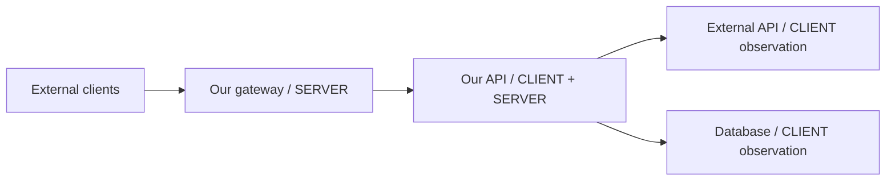
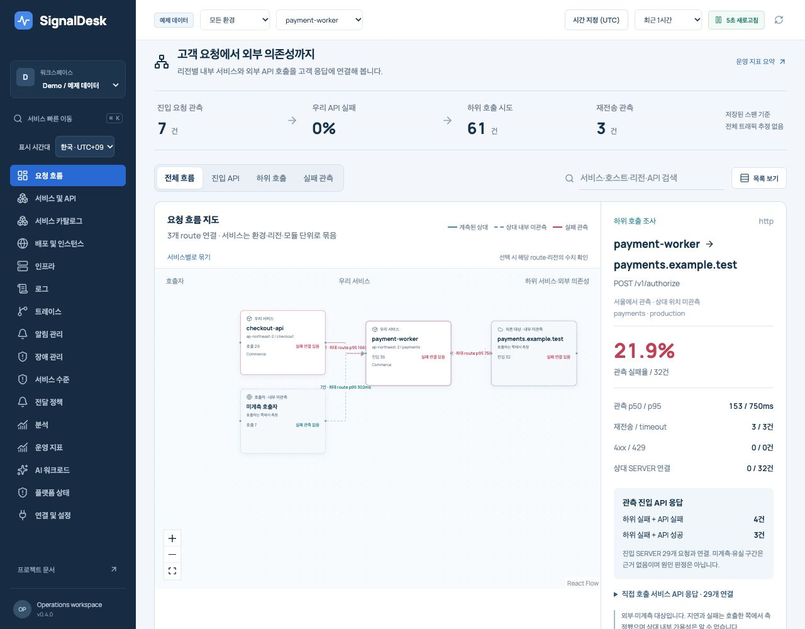
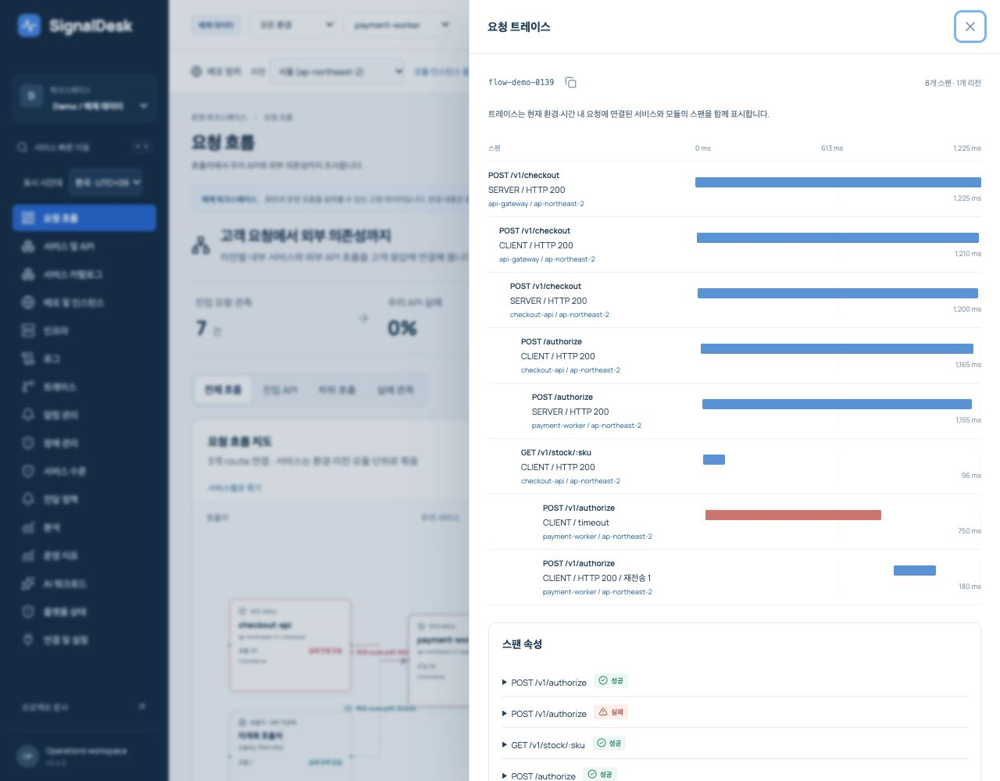
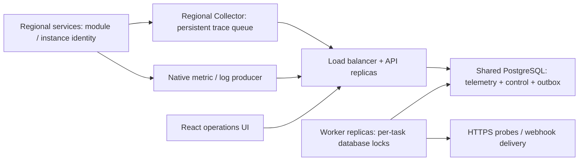
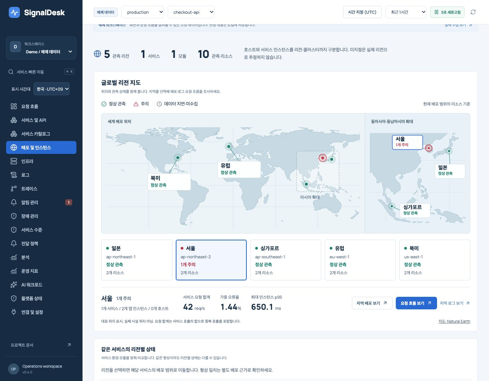
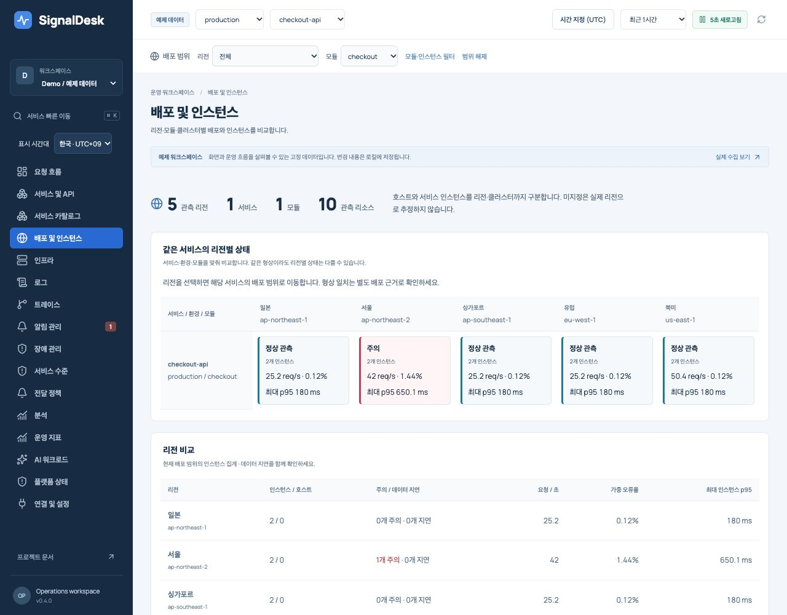

<div align="center">

# SignalDesk

**Follow a customer request through your APIs and dependencies.**

Servers · APIs · Logs · Traces · Alerts · Incidents · AI workloads

[](https://github.com/benny1020/signaldesk/actions/workflows/ci.yml)


[Quick start](#quick-start) · [Features](#features) · [Architecture](docs/ARCHITECTURE.md) · [Request-flow research](docs/REQUEST_FLOW_REDESIGN.md) · [Research](docs/RESEARCH.md) · [한국어](README.ko.md)

</div>



A dependency retry can fail while the final customer response succeeds. SignalDesk connects both outcomes without treating an unobserved provider as healthy.

SignalDesk is a self-hosted monitoring and incident workspace for engineers who need to move from a service symptom to logs, a request trace, an alert, and an incident timeline without losing context. It pairs a dense, readable interface with a working ingestion API, persistent storage and background evaluation.

**Release status: v0.4 request-flow workspace / internal pilot.** CLIENT/SERVER pairing, observed request/attempt percentiles, regional request maps, dependency rules, shared PostgreSQL API/worker execution, service ownership, SLOs, notifications and AI evaluation are implemented. Fresh v0.4 browser checks passed at 1280×900 and 390×844 for the map, numeric heatmap view, scoped trace/log investigation, dependency-rule editing and keyboard interaction. Screens below use Demo fixtures. Demo and Live are separate. Production volume, geographic failover and external model accuracy require deployment evidence; see [verification](docs/VERIFICATION.md) and [redesign decisions](docs/REDESIGN.md).

## Features

| Workspace         | Implemented behavior                                                                                                                                                    |
| ----------------- | ----------------------------------------------------------------------------------------------------------------------------------------------------------------------- |
| Request flow      | Caller → our services → dependencies; paired spans counted once, region/module expansion, observed p50/p95, timeout/429/retransmission and correlated final API outcome |
| Dependency rules  | Source/target/route-specific error percentage or p95, minimum evidence, unknown/stale status, multiple-worker locks and existing notification lifecycle                 |
| Deployments       | Regional comparison, per-resource inventory, six shared deployment filters, instance drilldown and explicit retirement/resume                                           |
| Operating metrics | Shared environment/service/time filters, request rate, request-weighted error percentage, maximum service p95, incident context and actionable service rows             |
| Services & APIs   | RED signals, full retained endpoint counts/errors/average/max latency, exact resource drilldown and partial trace discovery                                             |
| Infrastructure    | Real local CPU and OS memory collection every 5 seconds, timestamped host measurements; JSON ingestion for external hosts                                               |
| Logs              | Message/level search, virtualized rows, stable keyset pagination, JSON export, attributes and trace linking                                                             |
| Traces            | Indexed trace lookup, parent/child waterfall, duration, status and span attributes                                                                                      |
| Alerts            | Resource/region/service rule groups, group-aware preview, independent duration/recovery/no-data, acknowledgment and snooze                                              |
| Notifications     | Owner/dimension routing, policy preview, maintenance, separate firing/repeat/recovery receipts, retries and delivery health                                             |
| Incidents         | Independent states, owners, multiple linked alerts and persistent investigation notes/timeline                                                                          |
| Analytics         | Full retained log histogram/heatmap, service/environment/code/message error identities, source-backed relationship view                                                 |
| AI workloads      | Provider/model, token usage, reported cost with provenance, TTFT, AI latency and evaluation source/version; trace-linked evidence                                       |
| Operations        | Region-selected synthetic checks, platform/outbox/worker health, scoped roles, bounded capacity and audit trail                                                         |
| Catalog           | Stable service/team IDs, aliases, ownership, repository/runbook links, criticality, regions and orphan discovery                                                        |
| Service levels    | Revisioned availability/latency definitions, observed-span denominator, minimum coverage, error budget and burn alerts                                                  |
| AI evaluations    | Versioned structured datasets, candidate results, pinned baseline, exact-match scores/coverage/regressions, opt-in evidence gateway                                     |

The primary map uses **React Flow 12.12 + ELK 0.12** with layout in a lazy Web Worker, a disclosed graph cap and equivalent numeric connections. Selected connections show an **ECharts latency distribution heatmap** with real bin counts and empty gaps. Charts use modular **Apache ECharts 6.1**, with shared investigation range selection, missing-data gaps, series toggles, explicit units, CSV and numeric table alternatives. Absolute UTC bounds, KST/UTC display, saved views and detail URL restoration carry the investigation context. Logs use **TanStack Virtual** and paged server queries. React Query coordinates polling and invalidation. Reduced motion, native modal focus handling and small-screen layouts are included.





<details>
<summary>Historical v0.3 / v0.2 screens</summary>


</details>

## Quick start

Requires Node.js **24 or newer** and npm.

```bash
git clone https://github.com/benny1020/signaldesk.git
cd signaldesk
npm ci
npm run build
npm start
```

Open **http://127.0.0.1:4319**. Local mode binds loopback without a token. A seeded Demo workspace lets you inspect the entire workflow. Switch to **Live** to see actual local host measurements and self-instrumented API traces. Live logs appear when you ingest logs or the API returns a server error; synthetic sample logs are never labelled live.

Send real sample events from the included producer:

```bash
node examples/request-flow.mjs
node examples/send-sample.mjs
node examples/ai-span.mjs
```

The request-flow example makes actual loopback HTTP calls through two instrumented services to a simulated uninstrumented provider, then uploads CLIENT/SERVER spans and linked logs. [Instrumentation guide](docs/REQUEST_FLOW_INSTRUMENTATION.md) covers production OTel, propagation, redaction, sampling and boundaries. These examples send explicitly named `example-*` services to Live. They do not instrument your existing servers automatically. The AI example makes no model call and reports no fabricated cost.

### Development

```bash
npm run dev
```

Web: http://127.0.0.1:5178. API: http://127.0.0.1:4319. The `.env` file is loaded by the Node entrypoint. If you change the API port, update the development proxy in `apps/web/vite.config.ts`.

### Shared PostgreSQL deployment

```bash
npm run --silent credentials > .env
docker compose --env-file .env -f deploy/compose.distributed.yaml up --build -d
```

Open **http://127.0.0.1:4321** and enter the admin token from `.env`. This starts PostgreSQL, two API replicas, two workers and a load balancer. All writers use the same database. Worker ownership uses database session locks; alert and outbox publication is transactional. These containers run on one host; their region labels demonstrate resource scoping.

For a real regional deployment, use managed PostgreSQL HA, regional Collector persistent volumes, TLS and measured connection/capacity budgets. [Multi-region design and failure behavior](docs/MULTI_REGION.md) gives the deployment boundary and acceptance gates.


### Single-process Docker evaluation

```bash
npm run --silent credentials > .env
docker compose up --build -d
```

Open **http://127.0.0.1:4320** and enter the admin token from your local `.env`. Do not commit this file. The container runs as a non-root user in token mode and stores data in a named volume. Its local host collector observes the container's OS view, not necessarily your physical host. See [operations](docs/OPERATIONS.md) for deployment, backups and recovery.

## Connect a service

The native endpoint accepts a validated, atomic batch of up to 1,000 metrics, logs or spans. IDs make retries idempotent within a workspace. Timestamps are Unix milliseconds; events must fit the seven-day retention window and be no more than 60 seconds in the future.

```js
await fetch('http://127.0.0.1:4319/api/ingest', {
  method: 'POST',
  headers: { 'content-type': 'application/json' },
  body: JSON.stringify({
    workspace: 'live',
    events: [
      {
        id: 'orders-error-rate-' + Date.now(),
        kind: 'metric',
        timestamp: Date.now(),
        service: 'orders-api',
        environment: 'production',
        module: 'api',
        region: 'ap-northeast-2',
        cluster: 'commerce-prod',
        namespace: 'orders',
        instanceId: 'orders-pod-1',
        name: 'error_pct',
        value: 0.4,
      },
    ],
  }),
});
```

In token mode include `Authorization: Bearer <ingest-token>`. Never put a token in a URL. The lightweight [producer](packages/sdk/index.js) adds stable IDs, bounded batches, timeouts, retries and queue/drop counters. It is repository source, not a published npm package. Set its `resource` defaults once and flush from the application lifecycle. Its default retry queue is bounded in memory. The Node-only [durable producer](packages/sdk/node.js) adds a single-writer, fsync-backed journal with stable event IDs; [recovery contract](docs/OPERATIONS.md#durable-node-producer) describes disk capacity and lifecycle. The supplied regional Collector configuration persists **traces** to disk and exports gzip OTLP/HTTP JSON.

[API reference](docs/API.md) includes all operations, the trace bridge, roles and examples. **`/api/v1/traces`, `/api/v1/logs` and `/api/v1/metrics` accept bounded OTLP/HTTP JSON subsets. Metrics support gauge, sum and explicit-bucket histogram metadata; protobuf/gRPC, exponential histograms and a complete label-series engine are not implemented.** Do not point a default protobuf OTLP exporter at it and expect full compatibility.

## Architecture and extension points



`TelemetryStore` defines resource-scoped reads, indexed latest metrics and inventory. `ControlStore` owns rules, independent group states, incidents, audit and delivery transactions. Both PostgreSQL and SQLite implement `Storage`; APIs and workers use the same contracts. Prometheus, Loki, Tempo and ClickHouse adapters remain planned.

Resource identity separates monitored deployments from platform replicas. A worker evaluates each rule group independently, publishes one active alert per group and preserves concurrent acknowledgments/incident notes. PostgreSQL session-lock loss fences the old worker's database operations. SQLite supports one combined process; a shared SQLite volume is not a replica strategy. See [architecture](docs/ARCHITECTURE.md).

## AI monitoring

AI observability and AI-assisted operations have different evidence requirements:

- **Observe AI services:** correlate model/tool spans, latency, tokens and evaluations with server/API failures. Accept costs only with an explicit producer-supplied cost source. Missing cost and evaluations remain unknown. AI message and tool argument/result attributes are removed during ingestion.
- **Evaluate AI versions:** compare structured expected/actual fields against versioned datasets and a pinned baseline; persist failed fields, coverage and regressions. This is deterministic matching, not semantic correctness.
- **Investigate operations:** local evidence hypotheses remain the default. An optional configured HTTPS gateway requires explicit admin opt-in and receives bounded counts/identifiers, with source IDs checked on return. Provider accuracy is unverified; no automatic remediation exists.

Research covers Langfuse, Opik, Phoenix and the evolving OpenTelemetry GenAI conventions, including their actual license boundaries. [AI design and research](docs/RESEARCH.md#ai-observability-vs-aiops).

## Verification

```bash
npm run check
npm audit --audit-level=high
```

The suite covers atomic/idempotent ingestion, privacy, roles, resource isolation, weighted aggregates, independent group state, history, cardinality limits, gzip body limits and producer backpressure. CI additionally runs real PostgreSQL concurrency/lock-loss tests and four-process Docker acceptance, including a Collector disk queue through outage/restart.

```bash
docker build -t signaldesk:local .
npm run test:distributed
```

For new installations only: generating `.env` again rotates credentials and the channel key.

The distributed test creates isolated PostgreSQL and application containers, then removes its containers, volumes and temporary credentials.

Historical v0.3 manual browser acceptance covers the correlated navigation, alert actions, rule preview/create, incident notes/status, numeric chart view, AI workspace, real local collection and desktop/mobile rendering. [Verification record](docs/VERIFICATION.md) states what was actually executed and any remaining limits.

The [v0.4 research and design](docs/REQUEST_FLOW_REDESIGN.md) compares OTel, Google Dapper, Uber/Jaeger, AWS, Azure, Tempo and SigNoz using official material and six pinned GitHub source snapshots. Research patterns are implemented in original code; no upstream product assets/code were copied. Current-source research does not assert production feature parity.

The same application can be compared across independent European, North American, Japanese, Singaporean and Seoul deployments. Application services call internal services within their own region and then external dependencies; there are no inter-region application calls in this operating model. Regional telemetry feeds the central comparison workspace. A geographic overview pairs an offline world map with an Asian inset so nearby regions stay readable. Select a region to inspect its observed status and metrics, then open regional deployments, logs or request flows with the investigation scope preserved. Location markers use representative points, not facility locations; unregistered region codes stay in the equivalent selectable list. The new Demo keeps every trace's application spans/logs in one region. Compare service/environment/module rows and investigate each region's internal/external calls. [The five-region operating model](docs/FIVE_REGION_OPERATIONS.md) separates implemented behavior from release/digest drift inventory and real geographic resilience work.





## Operational limits

The [2026-10-09 OSS comparison review](docs/OSS_COMPARISON_REVIEW.md) identified R1–R7 correctness findings. They are repaired in v0.3 with regression tests and browser checks; broader parity gaps remain in the [roadmap](docs/ROADMAP.md). Passing CI does not establish parity with mature observability products or production readiness.

The [2026-10-10 Daangn and Toss research](docs/DAANGN_TOSS_RESEARCH.md) reviews official monitoring, notification, ownership, multi-cluster, SLI, UX and AI operations material, including seven presentation PDFs and six pinned GitHub repositories. The implemented follow-through and remaining limits are tracked in the [redesign record](docs/REDESIGN.md).

- PostgreSQL supports multiple API/worker processes; a primary database remains the write authority. Regional active-active databases and managed HA failover are not implemented by the app.
- Request-flow measurements describe retained observed spans. Pre-sampling RED metrics and dedicated high-volume trace/metric adapters remain planned. SQL rank percentiles are exact within the observed set; map labels use maximum route p95. A missing receiver can reflect sampling or loss, not only an external service.
- Seven-day retention; default 1,000,000-event ceiling, configurable with `MAX_EVENTS`. Capacity exhaustion rejects ingestion explicitly. Resource registry defaults to 20,000 identities/workspace (`MAX_RESOURCES`). Control entities also have limits.
- Detail samples cap at 10,000 metrics, 300 logs and 1,000 spans; logs page further. RED curves and API/log/error/AI/SLO summaries scan the full retained scope in SQL, with at most 1,000 result groups and explicit truncation. Observed spans are not a proven whole-traffic denominator. Host and individual AI charts remain bounded samples.
- Rules default to independent resource groups. Region/service aggregation sums request rates, uses request-weighted error rates and the maximum instance p95. This maximum is **not** a global population p95. Samples older than two minutes are no-data; exceeding evaluation bounds fails explicitly. Rules are not PromQL.
- Generic HTTPS webhook JSON, not a native Slack/Telegram/PagerDuty payload adapter. Delivery is at-least-once; receivers should deduplicate `deliveryId`. No Live credentials or destinations are preconfigured. Demo has a preview-only destination; its deliveries are cancelled before any network call.
- Token roles are a deployable baseline; SSO, user provisioning and organization membership are future work. Use HTTPS and a reverse proxy for remote access.
- Built-in redaction is a baseline, not a universal PII detector. Redact arbitrary sensitive log content before ingestion.

## Documentation

[v0.3 redesign](docs/REDESIGN.md) · [Product and UX](docs/PRODUCT.md) · [Architecture](docs/ARCHITECTURE.md) · [Multi-region](docs/MULTI_REGION.md) · [API](docs/API.md) · [Operations](docs/OPERATIONS.md) · [Request-flow research](docs/REQUEST_FLOW_REDESIGN.md) · [Research](docs/RESEARCH.md) · [OSS comparison review](docs/OSS_COMPARISON_REVIEW.md) · [Roadmap](docs/ROADMAP.md) · [Contributing](CONTRIBUTING.md) · [Security](SECURITY.md)

## License

Original SignalDesk code is [MIT licensed](LICENSE). Dependencies retain their licenses; bundled Manrope font files use OFL-1.1. Referenced monitoring products are design research, not copied UI or bundled code. See [third-party notices](THIRD_PARTY_NOTICES.md).
