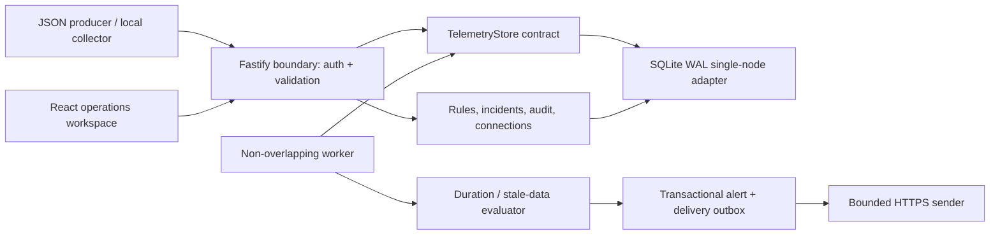

# Architecture

The control plane and telemetry adapter are separate modules. The bundled adapter uses indexed workspace/kind/time/service/environment partitions. Queries are bounded and explicitly indicate truncation. The API never treats a missing measurement as zero. New storage engines implement `TelemetryStore`; replacing SQLite telemetry does not change incident/rule contracts. A real remote engine requires equivalent scoping and aggregation tests; none is advertised as already implemented.

SQLite is appropriate for local evaluation and a single instance. One API process owns its collector and worker. Horizontal replicas are unsupported until scheduler leases, a shared transactional control database, durable queue and distributed storage exist. Seven-day retention and a hard telemetry ceiling bound disk/query work. Counters and health expose accepted/rejected records, storage occupancy, worker heartbeat and oldest pending delivery.

Ingestion is atomic, validates the whole batch, accepts stable event IDs for idempotency, strips AI message bodies and common credential attributes. AI costs are supplied by the producer with a rate/provenance label; the server does not guess provider prices. Query pagination uses `(timestamp,id)` keysets for logs/spans.

Alerts are states (pending/firing/resolved), acknowledgment and snooze are independent actions. No-data is a separate reason. A unique active alert per rule prevents repeated incident creation. Alert creation and its outbox jobs share a SQLite transaction. Successful delivery does not acknowledge or resolve an alert. Incidents have independent investigating/identified/monitoring/resolved states and timeline entries.

Local mode binds loopback and rejects cross-origin mutations. Token mode uses workspace-scoped admin/viewer/ingest tokens. Non-loopback binding requires token mode and a channel encryption key. This is a self-hosted baseline; SSO and organization membership management remain future work. Deploy behind HTTPS. Webhook/probe endpoints require HTTPS, public DNS addresses and pinned DNS resolution with redirects disabled; private destinations require explicit operator allowlisting.
