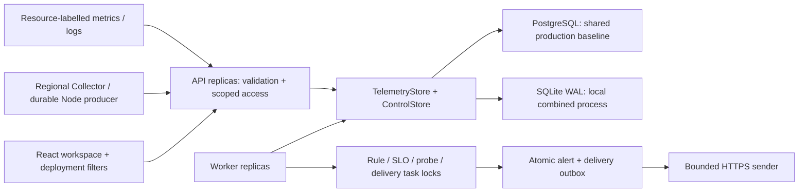

# Architecture

## Responsibilities

`packages/contracts/src/resource.ts` defines resource identity and selectors. Workspace is the access partition; service/environment/module/region/zone/cluster/namespace/instanceId form the resource tuple. Storage hashes its JSON tuple for a stable registry ID. Absent legacy dimensions become `unknown`; no geography is guessed. Production ingestion can require module, region and instance ID.

`TelemetryStore` owns atomic append, bounded scoped query, exact trace lookup, latest per-resource gauges, inventory, capacity, retention and optional full-scope aggregate queries. `ControlStore` owns rules, group state, alerts, incidents, settings, worker heartbeat, audit and delivery transactions. `Storage` combines them. SQLite and PostgreSQL implement these ports; an external telemetry adapter can be injected without replacing control contracts. Full remote Prometheus/Loki/Tempo/ClickHouse adapters remain planned.

PostgreSQL stores raw JSONB events with indexed workspace/kind/time/service/environment/resource columns. An indexed latest-metric table avoids scanning full retention for evaluation. Registry keeps first/last seen and explicit retirement. Late events preserve history without overwriting newer values. Ingestion validates the entire batch, strips sensitive attributes, deduplicates `(workspace,id)`, updates registry/latest gauges and capacity in one transaction. Cardinality/capacity rejection rolls back the whole batch. Historical latest queries use bounded indexed selection when newer reports exist.

## Replicas and ownership

Set `APP_ROLE=api` or `worker` with shared PostgreSQL. APIs do not run background tasks; workers expose database health but reject application API requests. `all` combines them for evaluation. SQLite refuses split roles and is limited to one process.

Migration and short control mutations take PostgreSQL transaction advisory locks. Concurrent incident notes therefore read and write serially. Rule, probe, delivery and retention work takes a per-task **session advisory lock on a reserved connection**. Independent tasks can use different workers; workers compete without a static leader. Pool-level or transaction-mode proxies cannot supply these session semantics. Use direct PostgreSQL or session pooling. Connection loss fences subsequent operations on the original worker context; it cannot silently switch to a fresh connection while continuing as owner.

## Rule and delivery semantics

Rules default to `groupBy=resource`; `region` and `service` aggregate matching identities. Each group has durable pending time/config revision and one unique active alert. Request gauges sum, error percentage is weighted by same-resource request rate, and p95 is a maximum rather than a population percentile. Missing aggregate weights return unknown. Registry retains expected identities so a disappeared instance becomes no-data. Explicit retirement stops its evaluation; unknown data never becomes zero. Rule edits invalidate pending duration. Work above query/resource bounds fails explicitly.

Each group uses a short control transaction, re-reading the current alert before updating it to preserve API acknowledgment/snooze changes. New alert and delivery jobs publish atomically. Delivery ownership is re-read under its task lock. Remote success followed by process failure may cause a repeat; receivers deduplicate `deliveryId`. External side effects are at-least-once, not exactly-once. Notification success does not acknowledge an alert or close an incident.

## Read and security boundaries

Every operational query scopes workspace and all selected deployment fields. Exact trace lookup intentionally expands service/deployment dimensions to show all correlated service children while retaining workspace, environment and time. In the current five-region operating model, application calls and their trace spans stay within the same region; regional telemetry supports central comparison. Existing multi-region trace history remains readable but is not a normal application route. Dashboard metric/log/span and inventory limits are explicit; alert views show current control state rather than reconstructing historical state. The resource registry is not a cloud discovery service.

Local mode binds loopback. Token mode uses workspace-scoped admin/viewer/ingest tokens. HTTPS, managed secrets and deliberate proxy trust are deployment responsibilities. Gzip requests are decompressed with a 1 MiB **expanded** body limit. Webhook/probe requests pin validated DNS and reject redirects/private destinations unless specifically allowlisted. AI cost requires producer provenance; prompt and tool bodies are stripped. SSO and universal PII detection are not implemented.

See [regional failure design](MULTI_REGION.md) and [operations](OPERATIONS.md) for deployment constraints.

## v0.3 operations and extension boundaries

`aggregate.ts` is a bound-parameter SQLite/PostgreSQL query planner. Only enumerated internal field names enter SQL; user selectors are values. It scans retained telemetry for RED bucket curves, log buckets, exact error identities, server/root endpoint and SLI counts, trace groups, AI versions and observed dependency attributes. Results expose source/window/step/truncation; 1,000 groups is a display bound, not proof that everything is present. SLI is an ungrouped denominator and has no 1,000-span dashboard cap. Missing gauge pairs produce unknown rather than a low biased error rate.

`operations.ts` owns revisioned service/team catalog, notification routes, maintenance, SLO definitions, versioned datasets and evaluation runs. Catalog aliases resolve a telemetry name to a stable service/team identity. Detection calls notificationPlan only after deciding alert state; the policy selects owner/dimension/severity channels and maintenance suppression. Delivery rechecks current policy. Outbox key is event_key/channel rather than alert/channel so repeat and recovery have independent durable receipts. Demo is an enforced no-transmission partition.

`evaluateSLO` is shared by API status and worker evaluation. Server/root spans are observed requests, error status/5xx is availability failure and latency thresholds count durations above the definition. Worker task ownership/revision checks fence concurrent configuration edits. Minimum coverage is explicit. No multi-window burn model, merged population histogram or cross-region database consensus is implied.

`diagnosis.ts` owns bounded evidence extraction, deterministic local hypotheses and a replaceable HTTPS model-gateway contract. External network work runs outside the global control lock. Structured outputs must cite current authorized evidence IDs, include counter/missing evidence and a next check. Gateway configuration plus explicit admin opt-in controls transmission. Dataset evaluation is a separate deterministic field matcher; missing candidate cases/fields reduce coverage. Neither component changes servers or incident status.

Frontend investigation modules live in `apps/web/src/investigation`; shared query/form helpers are separate. App URL is the investigation state: resource/time/search/detail/timezone. Selecting a detail freezes absolute bounds, log restoration uses exact scoped ID lookup and trace lookup includes correlated children across participating services. Each chart can narrow the shared time range and export visible numeric series. Hover cursors and deployment annotations are not yet synchronized across all charts.

The SQL baseline is horizontally scalable at the application tier but remains correctness-first at the database tier: single write authority, capacity row serialization, raw JSONB, no telemetry partitioning/rollups or ClickHouse/Mimir adapter. Contracts permit separate telemetry/control injection; adapter conformance and realistic volume measurement are still required before replacing the storage implementation. Durable Node journals are bounded single-process producers, not a distributed ingestion broker.

## Request-flow pipeline (v0.4)

`contracts/flow.ts` supplies boundary identities, evidence and dependency rules. `flow-sql.ts` builds parameterized SQLite/PostgreSQL queries; `flow.ts` maps aggregates to stable hashed graph IDs. SERVER and CLIENT are first-class span kinds, including OTLP numeric mapping. SQL deduplicates trace/span/environment, ranks receiver candidates once, pairs one CLIENT with at most one SERVER and follows bounded ancestry to the nearest SERVER response and a distinct root/trusted entry SERVER response. Missing entry ancestry stays unknown, even when the intermediate service succeeds. Receiver joins and selected-span joins avoid correlated rescans; PostgreSQL materializes SERVER candidates and ancestry ranks to prevent per-CLIENT window recomputation under selective filters; a real PostgreSQL test compares the complete output against SQLite for 1,101 attempts.

The frontend separates raw region-specific connections from an optional service-level visual grouping. React Flow renders a bounded, read-only topology. ELK runs in a lazily loaded dedicated Web Worker and terminates on scope changes. ECharts renders sparse duration distributions and time series; numeric lists expose the same returned values. URL edge selection pins the current absolute time window, and drilldowns replace the selected service's resource fields. Diagram layout, HTTP API and backend query timings are different measurements.

`dependency-monitor.ts` reuses these outgoing aggregates, per-task ownership and atomic alert/outbox publication. Evaluation rechecks revision/enabled state under the same control lock used by dependency definition writes, preserving disable and acknowledgment semantics. Evaluation status persists its timestamp and revision; missing, stale and insufficient evidence are explicit. No-data does not fabricate recovery. Monitors have bounded count/window/configuration cardinality.

The explicit Node tracing adapter propagates allowlisted W3C context and joins logs through AsyncLocalStorage. It captures host/template/status facts without request bodies/headers/raw URLs. Official OpenTelemetry instrumentation remains the recommended production integration. High-volume pre-sampling counters, complete OTLP transport, trace-ID-affine sampling gateways and dedicated trace/metric stores remain extension work. See [request-flow design](REQUEST_FLOW_REDESIGN.md) and [instrumentation](REQUEST_FLOW_INSTRUMENTATION.md).
