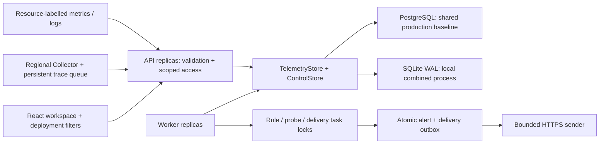

# Architecture

## Responsibilities

`packages/contracts/src/resource.ts` defines resource identity and selectors. Workspace is the access partition; service/environment/module/region/zone/cluster/namespace/instanceId form the resource tuple. Storage hashes its JSON tuple for a stable registry ID. Absent legacy dimensions become `unknown`; no geography is guessed. Production ingestion can require module, region and instance ID.

`TelemetryStore` owns atomic append, bounded scoped query, exact trace lookup, latest per-resource gauges, inventory, capacity and retention. `ControlStore` owns rules, group state, alerts, incidents, settings, worker heartbeat, audit and delivery transactions. `Storage` combines them. SQLite and PostgreSQL implement these ports; an external telemetry adapter can be injected without replacing control contracts. Full remote Prometheus/Loki/Tempo/ClickHouse adapters remain planned.

PostgreSQL stores raw JSONB events with indexed workspace/kind/time/service/environment/resource columns. An indexed latest-metric table avoids scanning full retention for evaluation. Registry keeps first/last seen and explicit retirement. Late events preserve history without overwriting newer values. Ingestion validates the entire batch, strips sensitive attributes, deduplicates `(workspace,id)`, updates registry/latest gauges and capacity in one transaction. Cardinality/capacity rejection rolls back the whole batch. Historical latest queries use bounded indexed selection when newer reports exist.

## Replicas and ownership

Set `APP_ROLE=api` or `worker` with shared PostgreSQL. APIs do not run background tasks; workers expose database health but reject application API requests. `all` combines them for evaluation. SQLite refuses split roles and is limited to one process.

Migration and short control mutations take PostgreSQL transaction advisory locks. Concurrent incident notes therefore read and write serially. Rule, probe, delivery and retention work takes a per-task **session advisory lock on a reserved connection**. Independent tasks can use different workers; workers compete without a static leader. Pool-level or transaction-mode proxies cannot supply these session semantics. Use direct PostgreSQL or session pooling. Connection loss fences subsequent operations on the original worker context; it cannot silently switch to a fresh connection while continuing as owner.

## Rule and delivery semantics

Rules default to `groupBy=resource`; `region` and `service` aggregate matching identities. Each group has durable pending time/config revision and one unique active alert. Request gauges sum, error percentage is weighted by same-resource request rate, and p95 is a maximum rather than a population percentile. Missing aggregate weights return unknown. Registry retains expected identities so a disappeared instance becomes no-data. Explicit retirement stops its evaluation; unknown data never becomes zero. Rule edits invalidate pending duration. Work above query/resource bounds fails explicitly.

Each group uses a short control transaction, re-reading the current alert before updating it to preserve API acknowledgment/snooze changes. New alert and delivery jobs publish atomically. Delivery ownership is re-read under its task lock. Remote success followed by process failure may cause a repeat; receivers deduplicate `deliveryId`. External side effects are at-least-once, not exactly-once. Notification success does not acknowledge an alert or close an incident.

## Read and security boundaries

Every operational query scopes workspace and all selected deployment fields. Exact trace lookup intentionally expands service/deployment dimensions to show cross-region children while retaining workspace, environment and time. Dashboard metric/log/span and inventory limits are explicit; alert views show current control state rather than reconstructing historical state. The resource registry is not a cloud discovery service.

Local mode binds loopback. Token mode uses workspace-scoped admin/viewer/ingest tokens. HTTPS, managed secrets and deliberate proxy trust are deployment responsibilities. Gzip requests are decompressed with a 1 MiB **expanded** body limit. Webhook/probe requests pin validated DNS and reject redirects/private destinations unless specifically allowlisted. AI cost requires producer provenance; prompt and tool bodies are stripped. SSO and universal PII detection are not implemented.

See [regional failure design](MULTI_REGION.md) and [operations](OPERATIONS.md) for deployment constraints.
