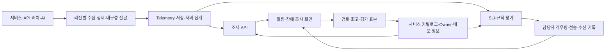

# 당근·토스의 모니터링 운영과 SignalDesk 적용 검토

조사일: 2026-10-10. 대상: 서버/API, 로그, 장애 분석, 알림, 여러 인스턴스·모듈·리전, 운영 UI/UX, AI 서비스 관측.

**SignalDesk의 다음 고도화는 서비스 소유권, 공통 운영 기준, 알림에서 시작하는 조사 흐름, 관측 데이터의 신뢰성에 집중해야 한다.** 공개 사례에서 얻은 설계 판단이다. 현재 기능이 당근·토스의 운영 수준에 도달했다는 의미가 아니다. 기존 [정확성 문제 R1–R7](OSS_COMPARISON_REVIEW.md)은 그대로 열려 있다.

## 조사 범위와 근거

공식 기술 글, 당근 공식 Notion의 발표 PDF 7편, 공개된 운영 화면, GitHub 저장소 6개의 README·라이선스·선택 소스를 확인했다. 저장소는 커밋 SHA, 파일 해시, fork 여부까지 [근거 목록](research/company-sources.json)에 기록했다. 발표 PDF는 텍스트를 추출하고 핵심 화면·도표를 렌더링해 확인했다. 원본 PDF·화면·코드는 이 저장소에 재배포하지 않는다.

- **확인:** 해당 팀이 특정 시점에 공개한 구현·운영 사례.
- **제안:** 그 사례를 바탕으로 우리가 설계한 SignalDesk 요구사항.
- **미확인:** 2026년 현재 회사 전체 구성, 내부 플랫폼 전체 UX, 비공개 알림 정책, 실제 장애 대응 성과.

토스 서버플랫폼, 토스증권, 토스페이먼츠를 구분한다. 2023년 Elasticsearch 사례와 이후 ClickHouse 사례가 공존하며, 전사적인 마이그레이션 완료를 입증하지 않는다. 당근의 2023년 Grafana legacy alert 한계도 현재 Grafana의 한계로 일반화하지 않는다.

## 1. 당근: 개발자가 직접 운영할 수 있는 플랫폼

### 서비스 기준 대시보드와 운영 지식의 축적

2023-06-15 발표는 Prometheus·Cortex·Loki 중심 구성과 Datadog의 보조 활용을 소개한다. namespace별 서비스 대시보드와 전역 상태 화면을 연결하고, USE/RED/Golden Signals를 서비스 상황에 맞춰 적용한다. 인프라별 Doctor Dashboard, 장애 후 대시보드 보강, 용량 계획까지 다룬다. **도구와 지표를 운영 지식으로 발전시키는 사례**다. [공식 발표, PDF 15–18·24–30쪽](https://daangn.notion.site/SRE-c62abc2b6f0347a4ace9ee9cdfc49b6b#5fb834078c8f47bd843129cb25cec4b6)

**SignalDesk 제안:** 모든 서비스에 같은 기본 조사 구조를 제공하되 API, 배치, 데이터 파이프라인, AI 서비스에 맞는 지표 묶음을 둔다. 인프라 전문 용어만 나열하지 않고 각 지표의 의미·단위·정상 기준·담당자를 표시한다. 장애 회고에서 유효했던 쿼리와 차트를 서비스의 저장된 조사 화면으로 남긴다.

### AlertDelivery: 알림을 담당자의 행동으로 연결

2023년 AlertDelivery 발표에는 namespace에 따른 분리, 담당자 정보, 서비스·로그 화면 링크, 반복 알림 제어, 조건별 멘션, Slack과 웹의 snooze가 나온다. 공개 화면에서 알림 유형 탭, namespace별 이력과 전체 상태 격자, snooze 수행자·잔여시간을 확인했다. Katalog의 오너십을 알림에 붙이는 점이 중요하다. [공식 발표, PDF 13–18·20–23쪽](https://daangn.notion.site/SRE-c62abc2b6f0347a4ace9ee9cdfc49b6b#048c19f37a66497aa13c0f8b2ec21560)

**SignalDesk 제안:** 알림 한 건에 영향 범위, 현재값/기준값, 담당 팀, 발생 시각, 반복 횟수, 서비스·로그·트레이스 바로가기를 붙인다. 조사 링크는 발생 시점의 절대 시간창과 리소스 범위를 보존한다. snooze는 대상·기간·수행자·사유를 기록하고, 감지 상태와 전송 억제를 분리한다. 담당자 ACK, 일시 중단, 장애 해결은 서로 다른 행동이어야 한다.

### Katalog와 멀티 클러스터 Kontrol

2023년 Katalog 발표는 프로젝트·팀·클라우드 리소스의 소유권을 연결하고, HR API와 AWS/GCP 라벨을 활용하는 구조를 제시한다. 멀티 클러스터 발표에서는 리전 활성화 설정과 리전별 배포 승인, 배포 파이프라인을 다룬다. 35쪽의 실제 UI에 프로젝트 등록, 담당 부서, 리전별 활성화, Slack 배포 구독 설정이 나온다. [Katalog, PDF 20–23·28–33·37·47쪽](https://daangn.notion.site/SRE-c62abc2b6f0347a4ace9ee9cdfc49b6b#cef363f18b77480cb882cd423c0adfde), [멀티 클러스터, PDF 14–22·31·35쪽](https://daangn.notion.site/SRE-c62abc2b6f0347a4ace9ee9cdfc49b6b#93fb6bcdab3d487ab22a882dcf7d8690)

2025-09-19 발표에서도 Kontrol의 IDP 확장과 지속적인 개발을 확인한다. 공개 소스 전체를 확보한 것은 아니다. [플랫폼 발전 발표](https://daangn.notion.site/SRE-c62abc2b6f0347a4ace9ee9cdfc49b6b#27628c3a9f8f805b8e88df89da278e4e)

**SignalDesk 제안:** `serviceId`와 `teamId`를 안정적인 식별자로 두고 서비스명·팀명 변경과 분리한다. 서비스 카탈로그에 저장소, 담당 팀, runbook, 중요도, 지원 리전, SLO를 연결한다. 리전별 배포 버전과 상태를 나란히 비교하고, 여러 인스턴스의 문제를 서비스 평균으로 감추지 않는다. `region`, `AZ`, `cluster`, `namespace`, `module`, `instance`의 역할을 별도로 유지한다.

### SLI를 플랫폼·차트·알림의 공통 기준으로

2025-09-19 SLI 발표는 운영 기준에 대한 팀의 합의와 작은 범위부터의 확장을 강조한다. PromQL을 API에서 직접 조합하는 방식의 복잡도·조회 비용을 줄이기 위해 recording rule을 사용하고, 같은 SLI를 플랫폼 조회와 알림에 재사용한다. [공식 발표, PDF 50–73·96–105쪽](https://daangn.notion.site/SRE-c62abc2b6f0347a4ace9ee9cdfc49b6b#27628c3a9f8f80098eabe7b66d6faf67)

**SignalDesk 제안:** SLI 정의를 서버 계약으로 버전 관리하고 차트와 규칙이 같은 집계를 사용하게 한다. 요청 성공률은 요청 수를 분모로 계산하며, 리전별 p95를 평균 내 전역 p95로 표시하지 않는다. 유효 요청/오류의 정의, histogram 경계, 기간, 제외 조건, 결측 기준을 명시한다. recording rule/rollup에는 갱신 시각과 평가 실패 상태도 필요하다. CPU 임계값과 사용자 경험 SLO는 별도 계층이다.

### Loki 운영: 관측 플랫폼 자체도 관측 대상

2025-09-19 Loki 발표는 rate limit, 저장 실패, 로그 로테이션과 수집 지연으로 생긴 누락, CPU throttling, 조회 큐·인덱스·스토리지·실행 시간의 병목을 다룬다. 실제 조회 패턴으로 병렬성·샤딩을 조정했고, 대규모 다운로드와 키워드 조회는 남은 과제로 제시한다. [공식 발표, PDF 34–84쪽](https://daangn.notion.site/SRE-c62abc2b6f0347a4ace9ee9cdfc49b6b#27628c3a9f8f801a89d2d65ee4a6ddbd)

**SignalDesk 제안:** 수집 성공률, 거부·폐기 이벤트 수, queue depth/oldest age, exporter 오류, 적재 지연, 조회 시간/실패/취소/잘림을 별도 화면으로 제공한다. 검색 결과가 없을 때 서비스 정상, 데이터 없음, 수집 장애, 조회 제한을 구분한다. Collector queue가 존재한다는 사실만으로 누락 방지를 보장하지 않는다.

## 2. 토스: 경로와 관계를 관측하고, 규모에 맞게 저장소를 선택

### 토스 서버플랫폼: Gateway의 API별 조사

2023-10-12 공개 글에서 Route ID·method·URI·상태 코드의 Elasticsearch 기록, Node Exporter/Actuator의 Prometheus 수집, Grafana 시각화와 Slack 알림을 확인했다. Route에 Path를 추가한 API별 지표, JVM/GC와 시스템 자원을 함께 살핀다. 저자 답변은 stateless Gateway의 다중 Pod와 카나리 배포도 설명한다. [토스는 Gateway 이렇게 씁니다](https://toss.tech/article/slash23-server)

**SignalDesk 제안:** API 목록과 상세를 서비스 아래에 둔다. 실제 URL 대신 정규화한 route template을 기본 집계 키로 사용해 ID별 시계열 폭증을 막는다. gateway/client/server 지연, HTTP 상태, timeout, circuit breaker, 버전·인스턴스를 연결한다. 단일 synthetic probe의 지연과 실제 요청 집단의 percentile은 구분한다.

### 토스증권: 대용량 로그와 파이프라인 운영

2023-10-12 Elasticsearch 개선 글은 일평균 56억 건 이상의 로그, 명시적인 필드 매핑, 인덱스·샤드 제어, slow query 관측을 설명한다. Logstash에서 Vector로 전환해 수집 파이프라인의 자원 비용을 줄이고, exporter로 파이프라인 자체를 관측했다. 데이터센터 간 단일 클러스터는 해당 환경의 조건부 선택이며 일반 권장으로 해석하지 않는다. [Elasticsearch 클러스터 개선기](https://toss.tech/article/slash23-data)

**SignalDesk 제안:** JSONB 이벤트 테이블을 모든 규모의 최종 저장소로 삼지 않는다. 수집/정제, 내구성 있는 전달, telemetry 저장, 집계 조회의 책임을 나누고 필드·라벨·retention·쿼리 비용의 예산을 둔다. 저장소 선택은 수집량·검색 유형·운영 비용을 측정한 뒤 확정한다.

### 토스증권: 서비스 관계를 데이터 결합으로 복원

Realtime Data Team의 공개 글은 약 10,000 Pod와 1,000 Topic 환경에서 Kafka의 METADATA request log, Consumer Group Lag, K8S conntrack을 결합해 서비스의 연결 관계를 찾는 사례다. ClickHouse에 메트릭·로그를 모아 SQL join과 Grafana 조회를 활용한다. 화면에는 cluster·service·topic 검색, Producer/Consumer 표와 서비스–Kafka 관계도가 나온다. **조회 시점에 확인한 글에는 발행일이 표시되지 않아 날짜를 추정하지 않았다.** [MSA 환경 Observability 높이기](https://toss.tech/article/MSA-observability)

**SignalDesk 제안:** HTTP trace만으로 서비스 지도가 완성됐다고 보지 않는다. Kafka/queue/DB/cache/external API 관계를 수집하는 어댑터를 추가할 수 있게 한다. 모든 edge에 관측 근거, first/last seen, 환경·리전, 유효 시간창과 coverage를 둔다. 선택한 서비스 주변부터 펼치고 관계도를 표로도 제공한다. 표본 트레이스가 없다는 이유로 연결이 없다고 표시하지 않는다.

### 토스페이먼츠: 모니터링과 장애 격리의 경계

2026-01-20 Infra Team 글은 Zabbix·Prometheus·Mimir, Grafana, CMDB·봇을 활용하는 운영을 소개한다. 독립적인 OpenStack 클러스터와 Active-Active 트래픽 운영도 설명한다. 관측 도구 구성과 실제 장애 영역의 독립성을 함께 다룬다. [하이브리드 클라우드 구축 사례](https://toss.tech/article/42673)

**SignalDesk 제안:** 여러 서비스 리전을 표시하는 것, SignalDesk API를 여러 프로세스로 실행하는 것, 플랫폼이 실제 리전 장애를 견디는 것은 각각 검증한다. 공유 DB·중앙 worker·alert destination이 실패할 때 지역별 수집, 조회, 감지가 어떻게 저하되는지 설계와 훈련으로 확인해야 한다.

## 3. 디자인·UI/UX: 공개 화면에서 확인한 패턴과 우리 판단

당근 AlertDelivery/Kontrol 발표와 토스증권의 관계 조회 화면을 직접 확인했다. **운영 화면 일부는 공개되어 있지만 전체 제품의 사용성과 접근성을 검증한 것은 아니다.** 소비자 앱의 브랜드 색상이나 큰 카드 구성만 가져오지 않는다.

| 확인한 공개 화면                             | 운영자에게 주는 이점              | SignalDesk에서 설계할 행동                                     |
| -------------------------------------------- | --------------------------------- | -------------------------------------------------------------- |
| 당근 알림에 담당자·서비스/로그 링크·snooze   | 알림 수신 후 별도 검색을 줄임     | 알림 행의 조사 버튼, 담당자, 기간이 있는 억제, ACK와 해결 분리 |
| 당근 namespace별 이력·유형 탭·전체 상태 격자 | 전체 영향과 개별 증거를 함께 파악 | 리전×서비스 상태 매트릭스에서 상세 조사로 이동                 |
| 당근 Kontrol의 리전 활성화·구독 설정         | 여러 배포 대상을 명시적으로 다룸  | 서비스별 리전·버전·인스턴스 비교와 변경 이력                   |
| 토스증권 cluster/service/topic 검색과 표     | 복잡한 관계를 좁힌 뒤 조사        | 검색 가능한 facet, 관련 관계만 확장, 정확한 증거 표            |
| 토스증권 서비스–Kafka 연결 그림              | 비동기 경로의 의존 관계를 설명    | 방향·종류·lag·최근 관측을 가진 edge와 동일 범위의 표           |

토스의 2025-07-04 TNS 사례는 사용자가 목표 기능에 도달하는 실제 경로를 측정하고, 결과 화면에서 혼동 구간과 개선 행동을 찾는 UX 리서치를 소개한다. **인프라 모니터링 제품에 TNS가 도입됐다는 증거는 아니다.** [TNS 제작기](https://toss.tech/article/Toss_Navigation_Score)

이를 참고한 우리 UX 검증 과제는 다음과 같다. 아래 시간은 성과 주장이 아닌 파일럿의 초기 목표다.

1. 알림에서 담당 팀과 영향 리전을 30초 안에 찾기.
2. 오류 급증 시점의 API → 로그 → 트레이스를 2분 안에 연결하기.
3. 다른 리전의 span으로 이동해도 잘못된 필터가 따라가지 않기.
4. 브라우저 뒤로 가기, URL 공유, 새로고침으로 같은 조사 상태를 재현하기.
5. 데이터 누락·표본·조회 제한을 보고 정상 상태로 오판하지 않기.

측정 항목은 성공률, 소요 시간, 잘못된 진입과 되돌아감, 필터 재입력, 잘못된 결론, keyboard-only 완료 여부다. 실제 운영자를 대상으로 수행하기 전에는 UX가 검증됐다고 말하지 않는다.

### 제안하는 화면 구조

- **서비스 중심 진입:** 담당 서비스/장애 → API → 인스턴스·리전 비교. 전사 보기는 별도 진입점을 제공한다.
- **공통 조사 헤더:** 서비스, 환경, 시간/시간대, 적용 필터, 데이터 최신성. 선택값을 URL에 보존한다.
- **차트와 증거 연결:** 같은 시간축의 RED/SLI 차트에 배포·알림을 표시하고 선택 구간으로 로그/트레이스를 좁힌다.
- **점진적 상세:** 영향과 다음 행동을 먼저 보여주고 원문·속성·JSON·query explain은 상세에서 연다.
- **색과 상태:** 빨강은 장애/위반 의미로 일관되게 쓰고, Producer/Consumer 종류는 문자·아이콘·방향으로 구분한다. 결측을 초록색 정상으로 칠하지 않는다.
- **읽기와 접근성:** 작은 글씨와 낮은 대비를 줄이고 dialog 이름·focus 복귀·단축키·차트의 수치 표를 검증한다.

### 시각화 기술 판단

기존 ECharts와 TanStack Virtual은 유지 후보다. 회사 공개 화면만으로 사용한 차트 라이브러리를 역추정하거나 새 라이브러리가 필요하다고 결론내리지 않는다. [기존 기술 비교](RESEARCH.md#visualization-technology-decision)를 바탕으로, 먼저 전체 기간 집계·공통 시간축·결측·주석·drilldown 정확성을 완성한다.

관계도가 커지면 별도 그래프 도구의 layout·keyboard·virtualization을 검토하되 검색·범위 축소가 먼저다. ClickHouse/Mimir/Loki 등을 연결했어도 조회 결과의 정확성, 취소·timeout·상한, 사용자 대기시간과 브라우저 메모리를 실제 데이터량으로 측정해야 한다.

## 4. GitHub: 사용할 수 있는 코드와 운영 증거를 구분

전체 공개 repo 목록은 당근 2페이지와 토스 1페이지를 확인했으며, 다음 6개를 선택해 커밋을 고정했다. 사내 관측 플랫폼 전체 소스는 확인하지 못했다. 포크 보유는 현재 실서비스 사용의 증거가 아니다.

| 저장소                                                                                                                        | 확인한 내용                                                                    | 판단                                                                                                   |
| ----------------------------------------------------------------------------------------------------------------------------- | ------------------------------------------------------------------------------ | ------------------------------------------------------------------------------------------------------ |
| [daangn/autopprof](https://github.com/daangn/autopprof/tree/f87ad098566ab2b1794aa0ecb58a4eec1f36edff)                         | Linux Go의 임계값 감시, CPU/heap profile, cooldown, Slack reporter; Apache-2.0 | 경보 시점의 프로파일을 증거로 첨부하는 패턴. Go/Linux 범위와 부하를 별도 검증                          |
| [daangn/webhook-cargo](https://github.com/daangn/webhook-cargo/tree/ccb0af3c6c556a698636f06965b1a5cb8231dcd2)                 | Cloudflare KV에 rule key별 payload 저장 후 scheduled forwarding; MIT           | 최신 payload로 덮어쓰는 debounce 참고. 장애 이력·복구 이벤트를 보존할 내구성 큐의 대체로 채택하지 않음 |
| [daangn/seed-design](https://github.com/daangn/seed-design/tree/22b68ce014c894edf286a2328a96250a36ab33a2)                     | 공통 토큰/레시피와 여러 플랫폼, React headless dialog 계약; Apache-2.0         | 의미 있는 상태 토큰과 overlay 동작 참고. 내부 모니터링 UI가 SEED라는 주장은 하지 않음                  |
| [toss/overlay-kit](https://github.com/toss/overlay-kit/tree/9f4e95ddbda28e2e6ee98cab971f3cdd11b2b8b2)                         | overlay open/close/unmount와 reducer 상태; MIT                                 | 열림·닫힘·제거를 분리하는 참고. 이것만으로 URL 동기화·접근성이 해결되지 않음                           |
| [toss/kubectl-flame](https://github.com/toss/kubectl-flame/tree/ba509a78bbe6df3cb12d71491223c8153b6a3798)                     | profiling/FlameGraph README·선택 소스; Apache-2.0, fork, 마지막 push 2021년    | 현대 container runtime 호환과 운영 권한은 미검증. 바로 설치·채택하지 않음                              |
| [toss/github-actions-exporter](https://github.com/toss/github-actions-exporter/tree/c6de1d6e0f2d107ba49318a86f9b678df2b78974) | workflow runs 메트릭; MIT, fork, README의 upstream 이전 안내                   | 배포/CI 상태 관측 패턴. 현재 유지보수·사용 여부를 보장하지 않음                                        |

제3자 프로그램을 실행하거나 운영 자원에 설치하지 않았다. 일부 프로젝트의 라이선스가 허용적이더라도 브랜드 자산·별도 패키지·이미지 권리까지 동일하다고 가정하지 않는다.

## 5. AI: 서비스 품질 관측과 운영 보조를 별도로 설계

토스증권의 2026-08-13 투자 정보 AI 사례는 근거를 구성하는 단계, 통제 가능한 생성 절차, 구조화된 평가 필드를 설명한다. 운영 실패를 평가셋·프롬프트·모델 버전으로 연결해 개선한다. **이것은 금융 정보 AI 운영 사례이며 인프라 장애를 AI가 자동 복구한다는 사례가 아니다.** [AI에게 투자정보를 말하게 하기까지](https://toss.tech/article/tech_talk_talk_1)

| 책임           | SignalDesk에 필요한 기능                                                                      | 현재와의 차이                                               |
| -------------- | --------------------------------------------------------------------------------------------- | ----------------------------------------------------------- |
| AI 서비스 관측 | provider/model/version, 단계별 latency/TTFT, tool 실패, retry/fallback, token·cost provenance | 현재 supplied span 기반 관측에서 실패 단계·버전 비교로 확대 |
| 품질 운영      | versioned dataset, evaluator/rubric, 평가 coverage, 실패 유형, baseline 비교                  | 공급받은 단일 score와 실제 평가 runner를 구분               |
| 장애 분석 보조 | incident 범위의 증거 조회 → 가설 → 근거/반증 → 추가 확인 단계                                 | 현재 deterministic briefing은 실제 LLM 분석이 아님          |
| 검증과 피드백  | RCA 가설의 근거 적합성, 오진/보류, 조사 시간, 호출 비용을 과거 장애에서 평가                  | 평가 전 정확도나 시간 절감 성과를 주장하지 않음             |

**제안:** 외부 AI는 opt-in으로 시작하고 권한이 허용한 telemetry만 비식별화·제한해 전달한다. AI 출력은 `hypothesis`, `supportingEvidence`, `counterEvidence`, `missingEvidence`, `nextCheck`처럼 재검토 가능한 구조를 갖는다. 입력 시간창·데이터 coverage·모델/프롬프트 버전도 기록한다. 출처 없는 원인 확정, 서비스 자동 변경, incident 자동 종결은 첫 적용 범위에 넣지 않는다. 민감한 원문을 보존하지 않는 환경에서도 허용된 구조화 실패 표본으로 평가할 방법을 별도로 설계한다.

당근의 인프라 자동 RCA나 양사의 전사적인 자율 복구 도입 여부는 이번에 확인한 공개 근거로 확정할 수 없다.

## 6. SignalDesk 적용 순서와 완료 기준

아래는 **개발 전 검토 결과**다. 이 문서 추가로 런타임 기능이 구현되지는 않았다.

| 순서 | 과제                     | 완료 기준                                                                                                                       |
| ---- | ------------------------ | ------------------------------------------------------------------------------------------------------------------------------- |
| 0    | 기존 R1–R7 수정          | 24h 데이터 누락, 교차 리전 필터, discovery, proxy/health quota, URL 복원, partial trace, error identity를 재현 자료로 회귀 확인 |
| 1    | Service Catalog·Owner    | 이름 변경에도 연결되는 ID, orphan owner 상태, 담당 팀·runbook·중요도·지원 리전 조회                                             |
| 2    | 조사 UX·API 분석         | URL로 동일 범위 복원, API별 RED, 인스턴스 비교, linked time window, 데이터 quality 표시                                         |
| 3    | AlertDelivery와 Incident | label 기반 routing, ACK/snooze/resolve 분리, audit, repeat/recovery, delivery receipt, 다중 알림의 장애 연결                    |
| 4    | 공통 SLI/SLO와 집계      | 차트/규칙 동일 정의, 요청 수 가중 성공률, histogram 기반 percentile, budget/burn-rate, 결측·갱신 상태                           |
| 5    | 저장소·수집 확장         | control plane과 telemetry store 분리, adapter conformance, retention/cardinality, 내구성 큐, 실제 부하·누락·재처리 검증         |
| 6    | 관계·플랫폼 상태         | 비동기 관계의 근거/TTL/coverage, 수집·적재·조회 상태, 리전 장애에서 가능한 기능과 저하 상태 검증                                |
| 7    | AI 품질·분석 보조        | 평가 runner/dataset/version, opt-in evidence 분석, 실패 표본 평가, 사람의 검토와 감사 기록                                      |

확장 방향은 PostgreSQL에 서비스·오너·규칙·권한·장애 같은 제어 데이터를 두고, telemetry를 목적에 맞는 저장소로 분리하는 것이다. ClickHouse 중심 분석과 Prometheus-compatible metrics/Loki/trace backend 조합을 **벤치마크 후보**로 비교한다. 두 회사의 스택을 모두 한 번에 넣거나 관측 저장 엔진을 직접 새로 만들지 않는다.

이 그림은 SignalDesk의 제안 구조이며 당근·토스 내부 아키텍처의 복제도가 아니다. 지역별 수집 내구성과 플랫폼의 지역 간 HA는 각각 수용 조건을 충족해야 한다. 기존 [멀티 리전 한계](MULTI_REGION.md), [로드맵](ROADMAP.md), [검증 경계](VERIFICATION.md)를 유지한다.
