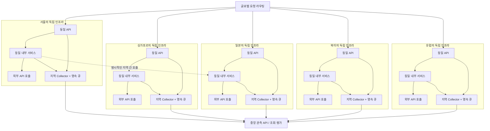

# 같은 형상, 다섯 리전의 독립 인프라

2026-10-12. 제품의 운영 전제는 **유럽·북미·일본·싱가포르·서울에 같은 논리 서비스와 모듈을 배포하고, 각 리전의 인프라는 독립 운영**하는 것이다. 같은 소스/이미지를 배포해도 트래픽, 외부 API 경로, DB·큐·캐시, 설정, 배포 시점과 장애 상태는 다를 수 있다.

## 공통 서비스와 지역 배포를 구분한다

| 책임         | 공통으로 관리                                          | 리전별로 관리                                                          |
| ------------ | ------------------------------------------------------ | ---------------------------------------------------------------------- |
| 애플리케이션 | 서비스명, 모듈명, API route 템플릿, 담당 팀, 계측 규칙 | 실행 인스턴스, 관측 상태, 배포 시각                                    |
| 형상         | 목표 release ID, Git commit, 불변 이미지 digest        | 관측된 실제 이미지/version, rollout 단계와 이전 버전 잔존 여부         |
| 인프라       | 구성 템플릿과 운영 기준                                | 클러스터·가용 영역·네임스페이스, DB·캐시·큐, 로컬 Collector/볼륨       |
| 외부 호출    | 공급자명과 API 계약                                    | 호출 서비스의 리전, 지역 endpoint, 타임아웃·429·재시도, 고객 응답 근거 |
| 알림         | 규칙 정의, 팀 전달 정책                                | 평가 그룹, firing/ACK/유지보수/복구 상태                               |

`service=checkout-api`를 지역마다 다른 서비스 이름으로 바꾸지 않는다. 식별 키는 `workspace + service + environment + module + region + zone + cluster + namespace + instanceId`다. 이미지 버전은 식별 키에 넣지 않는다. 이름이 같은 Pod/cluster가 여러 지역에 있어도 별개다. 인스턴스 ID는 수명 동안 안정적이고 새 Pod는 새 ID를 사용해야 한다.

**형상 일치 판정은 현재 구현하지 않았다.** 목표/실제 release·digest 인벤토리와 rollout 상태 API는 추가 구현 대상이다. 동일한 서비스명이나 같은 성능만으로 같은 코드라고 판정하지 않는다. 사용자 설명의 “형상은 같다”는 배포 전제로 기록하며 검증된 사실로 자동 표시하지 않는다. 지역별 endpoint·Secret·연결 수·feature flag 차이도 형상 불일치와 구분한다. 설정 비교에는 비밀 값 대신 비밀을 제외한 배포 설정의 버전/지문만 사용한다.

## 기본 호출과 리전 간 예외

이 그림은 배포 기준이며 실제 다섯 지역의 프로비저닝 증거가 아니다. 글로벌 트래픽 라우팅과 자동 failover는 애플리케이션 인프라의 책임이며 SignalDesk가 제어하지 않는다. 내부 API의 기본 경로는 해당 리전 내부다. 공유 글로벌 서비스 또는 명시적 지역 간 호출은 예외이며 원래 source/target 지역을 유지한다. 지역 간 호출이 관측되어도 그것을 자동으로 장애 우회라고 판정하지 않는다.

외부 API의 대상 지역은 상대의 계측 근거 없이는 알 수 없다. `서울의 서비스 → 공급자 endpoint`는 서울에서 관측한 호출이고, 외부 공급자도 서울에서 실행된다는 뜻이 아니다. 같은 외부 호스트에 대한 각 지역의 실패를 합쳐 지역 장애를 가리지 않는다.

## 구현된 메뉴 동선

| 메뉴              | 현재 동작                                                                                                                     |
| ----------------- | ----------------------------------------------------------------------------------------------------------------------------- |
| 배포 및 인스턴스  | 서비스·환경·모듈별 리전 비교 표, 관측 상태/데이터 지연, 인스턴스 수, 완전한 관측일 때의 요청량·가중 오류율, 최대 인스턴스 p95 |
| 리전 비교 표의 셀 | 해당 service/environment/module/region 범위로 좁히고 기존 zone/cluster/namespace/instance/edge 선택 해제; 시간 유지           |
| 모든 리전 비교    | 지역과 하위 인프라 필터를 해제해 선택 서비스·환경·모듈을 지역 간 비교                                                         |
| 요청 흐름         | 공통 서비스 묶음 또는 리전별 지도, 실제 source→target 경계, 리전 간 내부 호출 필터·설명                                       |
| 트레이스·로그     | 조사 시간/서비스/환경/리전/모듈을 연결; exact trace는 연결된 지역의 스팬을 함께 조사                                          |
| 알림·전달 정책    | `groupBy=region` 또는 resource로 평가; 리전별 전달·유지보수·ACK·복구 상태를 유지                                              |

비교 표는 **현재 필터의 관측 인벤토리** 기준이다. 전혀 등록되거나 관측된 적 없는 예상 리전은 자동 발견하지 않는다. 특정 서비스가 다른 관측 리전에 없으면 “관측 리소스 없음”, 관측이 오래되거나 지표가 부족하면 “데이터 지연·미수집”으로 표시한다. partial 인벤토리와 null을 정상·0으로 바꾸지 않는다. 표의 p95는 최대 인스턴스 p95이며 전체 요청의 통합 p95가 아니다. 하나의 서비스 행에서도 일부 인스턴스의 요청량/오류율이 없으면 완전한 합계/오류율을 표시하지 않는다.

## 운영 시나리오와 책임

### 지리 지도와 조사 동선

배포 메뉴의 **글로벌 리전 지도**는 관측 인벤토리를 지역별로 집계한다. 세계 지도에 관측된 등록 리전만 표시하고, 서울·일본·싱가포르는 아시아 확대도에서 이름과 상태를 분리한다. 색상뿐 아니라 상태 문구와 키보드 선택 가능한 목록을 제공한다. 지도의 선택은 지역 비교를 유지하면서 상세 지표를 바꾸며, **지역 배포 보기 / 요청 흐름 보기 / 지역 로그 보기**는 선택 리전으로 조사 범위를 변경한다. 기존 service/environment/module/시간은 유지하고 zone/cluster/namespace/instance/route/edge는 해제한다. 요청 흐름 이동은 이전 호출 방향 선택도 전체 흐름으로 바꾼다. 모바일에서는 세계 지도와 확대도를 세로로 배치한다.

좌표는 `packages/contracts/src/deployments.ts`의 `exampleRegions`에 있는 **대표 위치**다. 유럽은 더블린 부근, 북미는 미국 동부 부근으로 표시하는 예시이며 광역 리전 전체나 실제 시설 위치를 나타내지 않는다. 사용 중인 제공자/리전 코드에 맞춰 이 레지스트리를 수정해야 한다. 알려지지 않은 코드나 `unknown`은 지도 좌표를 추정하지 않고 “위치 미등록” 목록으로 조사할 수 있다. 예상 배포 목록은 아직 구현하지 않아 전혀 관측되지 않은 리전을 자동으로 표시하지 않는다.

지역 상태는 현재 목록의 활성 리소스를 기준으로 `주의 > 데이터 지연·미수집 > 정상 관측` 순으로 표시하며, 제외된 리소스는 집계하지 않는다. 서비스 요청 합계는 내부 호출 중복을 포함하므로 고객 진입 요청량이 아니다. 앱 인스턴스 중 하나라도 요청량/오류율이 누락되면 완전한 합계/가중 오류율을 표시하지 않는다. 호스트만 존재하는 지역에는 API 지표를 만들지 않는다. p95는 관측된 최대 인스턴스 p95이며 통합 분위수가 아니다. 지도 집계는 비교 표의 50행·12리전 상한을 사용하지 않으며, 지역 목록은 12개씩 페이지를 나눈다. API 인벤토리 자체가 잘리면 지도에도 경고한다.

지도 바탕은 [Natural Earth 1:110m land](https://github.com/nvkelso/natural-earth-vector/blob/ca96624a56bd078437bca8184e78163e5039ad19/geojson/ne_110m_land.geojson)의 public-domain 좌표를 고정 버전에서 SVG 경로로 변환한 것이다. `node scripts/generate-world-map.mjs`로 재생성한다. 경도·위도를 선형으로 배치하는 투영을 사용하며 실제 면적·거리 분석용이 아니다. 외부 지도 타일/API 키/브라우저 위치 정보가 필요하지 않고, 실제 호출을 확인하지 않은 지역 간 연결선은 그리지 않는다. 지도와 CSS는 배포 화면에서만 지연 로딩된다. [출처와 이용 조건](../THIRD_PARTY_NOTICES.md)를 참고한다.

비교 표는 최대 50개 서비스·환경·모듈 행과 12개 리전을 표시한다. 더 큰 인벤토리는 전체 개수와 표시 상한을 알리고 검색/범위 필터로 좁히도록 한다. 인벤토리 API 자체의 상한도 별도로 표시한다.

| 상황                                               | 조사 흐름                                                            | 현재 범위 / 추가 필요                                                                                  |
| -------------------------------------------------- | -------------------------------------------------------------------- | ------------------------------------------------------------------------------------------------------ |
| 같은 형상, 서울 API만 오류 증가                    | 서비스 리전 비교 → 서울 셀 → 인스턴스/로그·트레이스 → 지역 규칙 알림 | 지역 식별·비교·규칙 평가 구현; 배포/설정 비교 자동화는 추가 필요                                       |
| 일본에서 외부 공급자 timeout/429                   | 일본 scope → 하위 호출 → 재시도·진입 API 응답 → 근거 trace           | 관측·규칙 구현; 공급자 전용 운영 화면/쿼터·회선 분석은 추가 필요                                       |
| 서울→일본 내부 호출 지연                           | 리전 간 호출 → 실제 연결 선택 → CLIENT 지연/상대 SERVER → trace      | 관측된 경계 구현; DNS/TLS/네트워크 구간별 시간은 추가 계측 필요                                        |
| 한 지역의 telemetry uplink 단절                    | 플랫폼/배포 신선도 → Collector queue와 에러 → 재연결 후 replay       | Collector 영속 trace queue와 stale 표시 지원; 실제 WAN 시험·지역 Collector queue 상태 수집은 추가 필요 |
| 한 지역의 서비스 중단 후 다른 지역으로 트래픽 이동 | 지역별 요청량 변화 → 실패/근거 → 트래픽 라우터 이벤트와 대조         | 요청량 비교 구현; 라우터 이벤트 수집·우회 성공 판정은 추가 필요                                        |
| 점진 배포로 한 지역에 구버전 잔존                  | 목표/관측 artifact·rollout 비교 → 해당 지역 조사                     | 자동 형상 비교 미구현                                                                                  |
| 전 지역에서 동일 공급자 실패                       | 각 지역 source별 실패/고객 결과 비교 → 공통 incident 조사            | 각 지역 관측 가능; 자동 글로벌 공급자 사건 상관분석은 미구현                                           |
| 중앙 관측 DB 장애                                  | 지역 queue/backpressure 확인 → DB 복구 → 중복 없는 replay/평가       | 단일 write authority와 replay 기반; 실제 지리적 HA/PITR는 미검증                                       |

관측 시스템 장애와 서비스 장애를 구분한다. Collector 단절로 데이터를 못 받았다고 서비스 장애를 확정하지 않는다. 데이터가 사라졌다고 기존 장애를 복구로 판정하지 않는다. 하위 호출 규칙은 최소 관측 수 미달이면 unknown이며 기존 활성 알림을 유지한다. 일반 metric no-data 정책과는 별개의 동작이다.

## 수집·저장 경계

각 리전은 로컬 Collector와 독립된 영속 큐를 둔다. 애플리케이션의 `cloud.region`은 신뢰된 배포 환경에서 주입하고, 리전별 cluster/zone/instance identity를 로그·메트릭·스팬에 일관되게 제공한다. 클라이언트가 보낸 HTTP 헤더로 지역이나 서비스 식별을 덮어쓰지 않는다. 기존 Collector는 resource가 없을 때 REGION/CLUSTER를 삽입하며, 기존 잘못된 값의 교정/위조 방지 또는 토큰의 리전별 권한을 자동 제공하지 않는다.

현재 배포 예제는 지역 trace queue → 공통 ingest API → 하나의 PostgreSQL write authority다. 로그·메트릭의 영속 수집 경로와 지역별 end-to-end 상태는 별도 [운영 가이드](OPERATIONS.md)·[다중 리전 수집 경계](MULTI_REGION.md)를 따른다. 중앙으로 보낼 수 있는 데이터 범위/보존 정책은 실제 운영 정책에 맞춰 결정해야 한다. 지역 내 저장과 중앙 집계 조회가 필요한 경우 지역 저장 adapter, 조회 권한, 재해 복구와 집계 프로토콜을 추가 구현·검증해야 한다. 같은 DB를 다섯 지역의 독립 writer로 복제하여 나중에 알림을 합치는 구조는 현재 지원하지 않는다.

## 데모와 검증

신규 Demo는 다섯 지역에 동일한 여섯 서비스와 서비스당 두 인스턴스, 지역별 클러스터와 호스트를 만든다. 대부분 내부 호출은 지역 내이며 일부 명시적 리전 간 호출을 포함한다. 서울 checkout 장애를 다른 리전과 비교할 수 있다. `eu-west-1`, `us-east-1`, `ap-northeast-1`, `ap-southeast-1`, `ap-northeast-2`는 **예제 코드**이며 실제 클라우드 사업자·유럽/북미 도시를 확정한 설정이 아니다. Live의 다른 지역 식별 문자열도 지원한다.

기존 Demo DB의 기록은 자동 삭제·다시 쓰지 않는다. 최신 예제를 보려면 별도 신규 DB를 사용하거나 `DATABASE_PATH=<대상 SQLite DB> npm run demo:reset`으로 Demo만 재생성한다. Live를 재생성하지 않는다.

`multi-region.test.ts`는 다섯 지역의 동일 서비스/동일 인스턴스명 식별, 지역 내 기본 호출·명시적 지역 간 호출, 서울만 firing/복구, 환경·모듈 구분, 데이터 미수집/부분 지표/퇴역 호스트 경계를 검증한다. 이 검증은 실제 유럽·북미·아시아 네트워크나 운영 배포를 시험한 것이 아니다.
