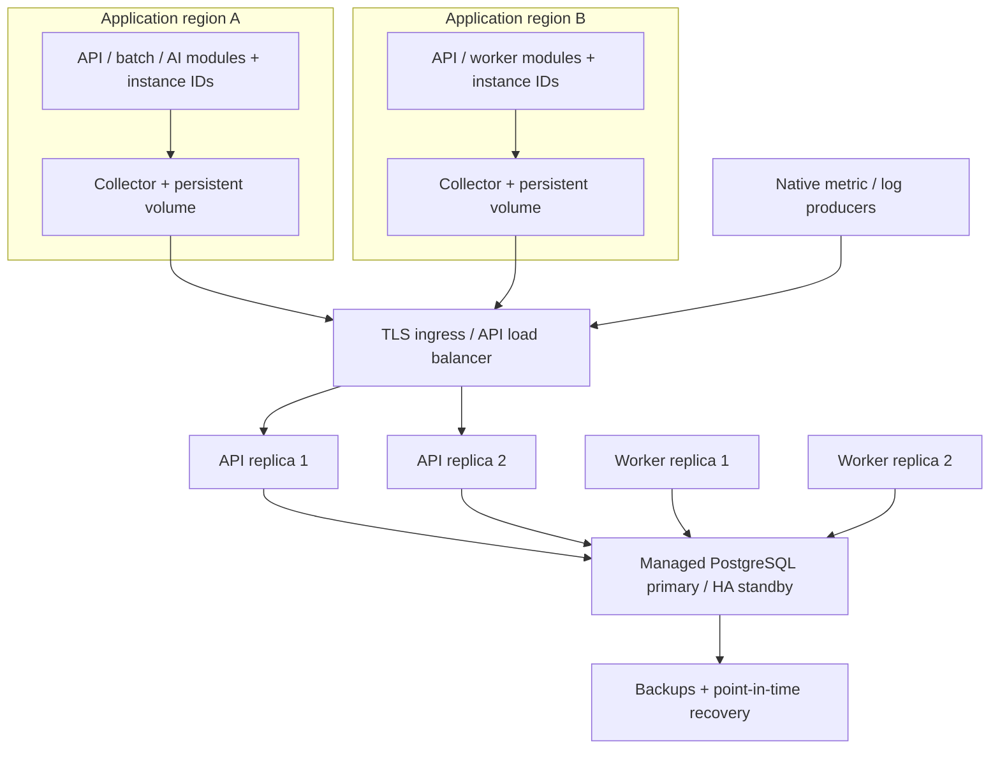

# Multiple instances, modules and regions

v0.2 addresses two independent dimensions: the deployments being observed and the processes serving the platform. Both are implemented; geographically distributed production failover remains an operator acceptance exercise.

## Identity and observation

```
workspace
  service + environment
    module + region + zone + cluster + namespace + instanceId
```

Use service names consistently, module for API/batch/worker boundaries, and stable instance identity for the lifetime of each process/Pod. Prefer Pod UID or a deployment-generated process ID over a reusable Pod name. Kubernetes namespace is separate from service namespace/module. Autoscaling creates new identities; retire drained instances explicitly in the deployment screen or resource API. Automatic Kubernetes/cloud lifecycle discovery is planned. Capacity includes retired identities until an operator-supported archival feature is added.

OpenTelemetry mapping: `service.namespace` → module (custom `signaldesk.module` wins), `cloud.region`, `cloud.availability_zone`, `k8s.cluster.name`, `k8s.namespace.name`, `service.instance.id` (fallback Pod UID), `host.id`/`host.name`. Strict ingestion requires module, region and instanceId. Fields are bounded to prevent uncontrolled metadata cardinality.

## Reference topology



The primary database is the write/lock authority. Keep workers near it; API placement depends on measured WAN latency and ingestion budget. Do not create independent writable copies and merge alerts afterward. A managed standby and failover endpoint are infrastructure responsibilities. `deploy/compose.distributed.yaml` is a reproducible **single-host** 2-API/2-worker topology, not an actual regional HA deployment. Region labels on these containers are test dimensions.

## Regional trace buffering

`deploy/otel-regional.yaml` uses Collector contrib **0.162.0**, OTLP HTTP reception, resource enrichment, memory limiter, bounded batch and `otlp_http` JSON export. The persistent queue uses `file_storage`, fsync, 10,000 queued requests and a 256 MiB file limit. This component is beta in the pinned upstream release; validate upgrades and volume recovery.

Provide `REGION`, `CLUSTER`, `SIGNALDESK_TRACES_ENDPOINT` (including `?workspace=live`) and `SIGNALDESK_INGEST_TOKEN` through secret-aware deployment configuration. Bind receiver to a private network or add receiver authentication/TLS before exposing it. The official image runs as **10001:10001**; provision `/var/lib/otelcol` as a writable persistent volume owned by that UID. Preserve the volume across rescheduling and ensure a single Collector owns each queue directory. A new empty ephemeral volume cannot recover the old queue.

Only traces are exported by this config. Native log/metric SDK queues are bounded in-memory retries and need a durable broker/agent for restart survival. A request accepted into the Collector receiver before batch flush is not a blanket durability guarantee. Queue exhaustion can reject, oversized/permanently invalid payloads can drop, and data older than the API's seven-day retention is rejected. Size queues for measured outage duration, not a zero-loss promise.

## Failure behavior

| Failure                                | Implemented behavior                                                                         | Remaining operational requirement                                                         |
| -------------------------------------- | -------------------------------------------------------------------------------------------- | ----------------------------------------------------------------------------------------- |
| API process exits                      | Other API shares the same DB; retry same event IDs deduplicates                              | Health-based ingress and client backoff; verify real proxy recovery                       |
| Worker exits                           | Session lock releases; surviving worker can acquire task, durable group/outbox state remains | Stable DB connections, worker freshness monitoring                                        |
| Worker DB connection is killed         | Old worker's subsequent DB operations are fenced; new owner can acquire                      | Do not use transaction pooling; existing external HTTP request cannot be recalled         |
| Application region disconnected        | Trace queue retries/replays when connectivity returns; resource becomes stale/no-data        | Persistent regional storage, outage capacity and recovery drills; durable metric/log path |
| All control DB access fails            | `/health` fails, API cannot accept, worker cannot progress; never invent healthy state       | Managed DB HA/failover, collector buffer and restore rehearsal                            |
| Retired/drained instance               | Explicit retirement prevents no-data alerts and resolves active group on next worker tick    | Lifecycle automation/discovery is future work                                             |
| Duplicate outbound success after crash | Delivery ID stays stable for receiver deduplication                                          | Receiver idempotency; delivery is at-least-once                                           |

## Aggregation and volume planning

Send each instance's own request rate and error gauge; do not repeat a service-wide total on every Pod. Error rate is weighted only when matching request weights exist. `max(instance p95)` highlights worst-instance latency but cannot produce true global p95; a future histogram/Prometheus adapter must merge bucket counts. Root-span success is sampled trace evidence, not total-traffic availability. Missing metrics and truncated views are visible.

Default bounds: 1,000,000 retained events across workspaces, 20,000 identities per workspace, seven-day retention. For 1,000 instances producing three gauges every five seconds, metrics alone are **51.84 million events/day**, beyond this PostgreSQL baseline. Do not simply raise a ceiling and claim production capacity. Use measured batching/rollups/retention and a time-series or columnar backend. ClickHouse/Prometheus/Loki/Tempo adapters and partitioned telemetry retention are planned; the shared contracts are the extension boundary.

Budget connections: `(API replicas + worker replicas) × PG_POOL_SIZE`, plus migrations, monitoring and reserved admin headroom. Each running worker task reserves a session connection. Default pool size is 10 per process; test real workload before increasing replicas. The current capacity counter and short global control transaction lock are correctness-first serialization points, so measure contention. No throughput benchmark on managed PostgreSQL or WAN is claimed.

## Production acceptance gates

1. Instrument real services with identities, check duplicate/late events and cardinality during scale-out/in.
2. Provision TLS, managed secrets, DB HA/PITR and regional persistent volumes; rehearse backup restore.
3. Break WAN connectivity, restart/reschedule Collectors with preserved volumes, and validate queue bounds/expired data behavior.
4. Kill API/worker processes and DB sessions under sustained ingest; verify alert/outbox/idempotency and backpressure.
5. Perform managed PostgreSQL primary failover and DNS/connection recovery; verify no duplicate active alerts.
6. Measure ingestion/query p95, connection pressure, retention and cardinality on intended volume. Tune or replace telemetry backend using measured evidence.

Automated local PostgreSQL and multi-process/Collector checks are in [verification](VERIFICATION.md). These gates are deployment prerequisites, not claims that geographically separated infrastructure has already been provisioned.

Sources: [OTel service resource conventions](https://opentelemetry.io/docs/specs/semconv/resource/service/), [cloud resource conventions](https://opentelemetry.io/docs/specs/semconv/resource/cloud/), [PostgreSQL advisory locks](https://www.postgresql.org/docs/current/explicit-locking.html#ADVISORY-LOCKS), [Collector file storage at the pinned release](https://github.com/open-telemetry/opentelemetry-collector-contrib/blob/v0.162.0/extension/storage/filestorage/README.md).
