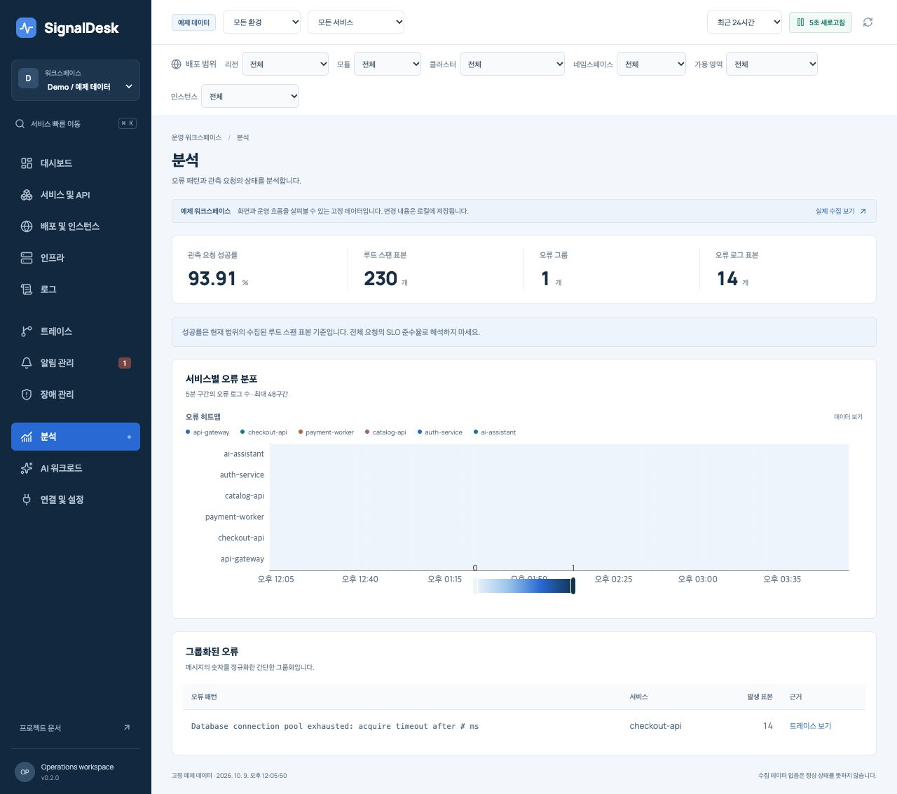
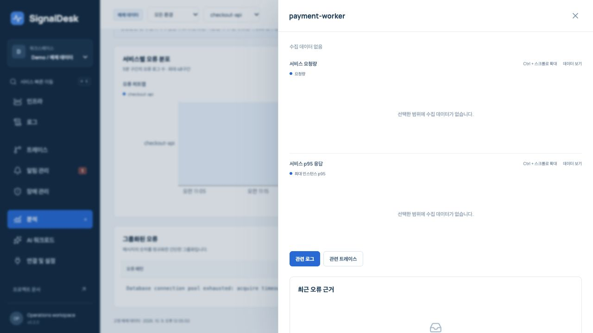

# SignalDesk 오픈소스 비교 리뷰

검토일: 2026-10-09. 대상: v0.2.0, 커밋 `fbfbdeec79417d4d9ab5759f9a7b9c5042920c0d`.

**현재 구현을 최대한 고도화된 운영 플랫폼이라고 평가할 수 없다.** 멀티 리전·모듈·인스턴스 식별, 데이터 없음 처리, 공유 PostgreSQL 실행과 기본 장애 조사 흐름은 구현했다. 그러나 성숙한 관측 제품의 탐색 기능, 알림 운영, 저장 엔진, AI 평가 운영과 비교하면 상당한 격차가 있다. 이번 검토에서는 기능 누락과 별개로 **수정이 필요한 정확성·조사 흐름 문제 7건**도 확인했다. 이 보고서는 리뷰 결과이며 해당 문제를 수정한 릴리스가 아니다.

## 검토 방법과 한계

- 8개 GitHub 저장소의 특정 HEAD를 고정하고 33개 소스·라이선스 파일을 선택해 읽었다. 파일 목록, SHA와 다운로드 내용 해시는 [원본 출처 목록](review/upstream-sources.json)에 기록했다. 저장소 전체를 감사했다는 뜻은 아니다.
- Grafana Play의 Explore를 직접 탐색했다. SigNoz 공식 로그 탐색 문서와 Langfuse 공식 실험 비교 문서의 UI 이미지를 확대해 확인했다. 나머지는 공개 문서와 선택한 UI·구성 소스로 비교했다. 모든 제품을 설치하거나 상용 기능까지 실행한 비교는 아니다.
- SignalDesk의 실제 브라우저 화면과 현재 서버 소스를 대조했다. 읽기 전용 Demo API와 별도 메모리 DB, Fastify 주입 요청으로 경계 사례를 재현했다. 운영 데이터를 초기화하거나 외부 알림을 발송하지 않았다.
- [재현 결과](review/reproduction-evidence.json)에 확인 방식과 결과를 분리했다. 브라우저 재현, 실제 서버 함수 재현, 소스 알고리즘 재현은 서로 다른 근거 수준이다.
- 기존 [CI](https://github.com/benny1020/signaldesk/actions/runs/37878061092)는 대상 커밋에서 성공했다. 그 사실은 이번에 발견한 사례의 정확성이나 운영 준비를 보증하지 않는다. 이번 검토는 공통 부하 벤치마크, 실제 WAN 장애, PostgreSQL HA/PITR 또는 외부 채널·모델 연동 시험을 포함하지 않는다.
- 기존 390px [모바일 스크린샷](screenshots/mobile.png)은 시각 검토했다. 이번 브라우저 도구에서 390px 설정 후에도 실제 폭이 1280px로 반환되어 **새 모바일 동작 검증은 완료로 기록하지 않는다.**

## 비교 대상과 참고할 책임

라이선스는 각 고정 커밋의 루트 LICENSE를 확인했다. 오픈 코어 제품의 루트 소스가 공개되어 있다고 모든 Enterprise/Cloud 기능이 OSS인 것은 아니다. 소스를 복사해 도입하는 제안이 아니다.

| 제품                                                                                                     | 검토한 HEAD | 주 비교 대상                                        | 확인한 라이선스 범위                           |
| -------------------------------------------------------------------------------------------------------- | ----------- | --------------------------------------------------- | ---------------------------------------------- |
| [SigNoz](https://github.com/SigNoz/signoz/tree/5f8fa52e7cda3b345df755f097b476f4114c7415)                 | `5f8fa52e`  | 통합 로그·트레이스 탐색, 쿼리, 저장한 뷰, 시간 선택 | 일반 코드 MIT, `ee/`·enterprise 별도           |
| [Grafana](https://github.com/grafana/grafana/tree/9e4ddd2581aecdcab2c34bfba1827789f17fb358)              | `9e4ddd25`  | 대시보드 구성, Explore, 시간·타임존, 알림 정책      | AGPL-3.0; Play의 Cloud 앱은 별도로 구분        |
| [OpenObserve](https://github.com/openobserve/openobserve/tree/749db41b6327c8e3bafc6c9cd47a771c2368de14)  | `749db41b`  | 로그 검색, 저장한 뷰, 필드·컬럼 조작                | 루트 AGPL-3.0; 개별 상용 기능은 별도 확인 필요 |
| [Alertmanager](https://github.com/prometheus/alertmanager/tree/ae962109158fa50c90ea425f2bb97887ebe2fc50) | `ae962109`  | 알림 라우팅, 그룹 타이머, 억제, 채널 구성           | Apache-2.0                                     |
| [Keep](https://github.com/keephq/keep/tree/465e99152e7586fcbe4c2732213d31c5c28def4b)                     | `465e9915`  | 여러 알림의 사건 상관분석, 장애 목록 조작           | 일반 코드 MIT, `ee/` 별도                      |
| [OneUptime](https://github.com/OneUptime/oneuptime/tree/e6b37dcae85ae913044379e221ca48c8f0250f37)        | `e6b37dca`  | 온콜 일정·단계별 에스컬레이션                       | 일반 코드 Apache-2.0, `ee/` 별도               |
| [Langfuse](https://github.com/langfuse/langfuse/tree/2cc5e6b936c40a85cf25c5c3d558333433d003fa)           | `2cc5e6b9`  | AI 트레이스·테이블 탐색, 실험별 품질·비용·지연 비교 | 일반 코드 MIT, 명시된 `ee/` 디렉터리 별도      |
| [Opik](https://github.com/comet-ml/opik/tree/a597c52d93354f5848aa2867e6a9cc6bdd02abba)                   | `a597c52d`  | AI 트레이스 세부 탐색, 실험 결과·점수·구성 비교     | 루트 Apache-2.0                                |

이 제품들의 모든 기능을 합친 목록을 그대로 만드는 것이 목표는 아니다. 서버·API 운영자가 **문제 발견 → 영향 범위 → 원인 근거 → 담당자 대응 → 복구 확인**을 끝낼 수 있는지가 판단 기준이다.

## 기능별 판정

`구현`은 해당 기능의 현재 좁은 범위가 작동한다는 뜻이며 경쟁 제품과 동등하다는 뜻이 아니다. `부분`은 핵심 일부만 있다. `없음`은 현재 코드에서 제공하지 않는다. `미검증`은 설계·기존 테스트로 실제 운영을 입증할 수 없다.

| 영역               | SignalDesk 현재 상태 | 비교 결과와 부족한 부분                                                                                                  | 우선순위 |
| ------------------ | -------------------- | ------------------------------------------------------------------------------------------------------------------------ | -------- |
| 운영 개요          | 부분                 | RED, 사건·알림, 근거 링크가 연결됨. 팀별 홈·저장한 레이아웃·사용자 관심 서비스 없음                                      | P2       |
| 대시보드 구성      | 없음                 | Grafana처럼 패널 추가·이동·설정, 변수, 저장·버전·템플릿·프로비저닝 불가                                                  | P2       |
| 시간 탐색          | 부분                 | 상대 범위 4개와 URL의 절대 시간 지원. UI 절대 시각 입력·타임존·이전 구간 비교 없음                                       | P1       |
| 그래프 조사        | 부분                 | 단위, 툴팁, 범례 선택, 로컬 확대, 숫자 표 있음. 공유 커서·전체 범위 확대·배포/알림 주석·차트 CSV 없음                    | P1       |
| 서비스·API APM     | 부분                 | 서비스 RED와 최대 인스턴스 p95. 엔드포인트별 분석, Apdex, DB/외부 호출 요약, 프로파일링 없음                             | P1       |
| 리전·모듈·인스턴스 | 구현/부분            | 전체 식별 튜플·범위 조회·독립 알림 그룹 구현. 자동 발견/은퇴, 배포 버전·변경 이벤트·리전 비교 작업 공간 없음             | P1       |
| 호스트 인프라      | 부분                 | CPU·메모리만 기본 수집. 디스크·네트워크·프로세스·컨테이너·Kubernetes 상태 없음                                           | P2       |
| 로그 탐색          | 부분                 | 메시지·레벨 검색, 가상화, 커서 페이지, JSON 내보내기. 속성 AND/OR·제외·자동완성·필드 컬럼·전후 문맥·저장한 뷰 없음       | P1       |
| 트레이스 탐색      | 부분                 | exact trace는 다른 리전 포함. 목록은 루트만 표시하며 검색·정렬·상태/지연 필터·다음 페이지 UI 없음                        | P1       |
| 워터폴·토폴로지    | 부분                 | 기본 시간 막대·부모 깊이·작은 SVG 연결도. 클릭한 스팬 중심 조사·리전 표식·확대/검색·critical path 없음                   | P1       |
| 오류·장애 분석     | 부분                 | 단순 숫자 정규화와 현재 표본 집계. 서비스별 fingerprint, stack trace 그룹, 발생 추세·영향 사용자·릴리스 회귀 없음        | P1       |
| SLO/SLI            | 없음                 | 관측 루트 스팬 성공률은 SLO가 아님. 전체 트래픽 기준 SLI·오류 예산·다중 구간 burn-rate 없음                              | P1       |
| 알림 평가          | 부분                 | 임계치·지속 시간·no-data·resource/region/service 그룹. 표현식·복합 조건·히스토그램·로그/스팬 기반 규칙 없음              | P1       |
| 규칙 운영 UX       | 부분                 | 생성·현재 값 미리보기·활성 전환만 가능. 기존 규칙 수정·복제·버전·그룹별 상태·과거 재평가 UI 없음                         | P1       |
| 알림 전달          | 부분                 | HTTPS webhook·영속 outbox·최대 5회 재시도·수동 재시도. 네이티브 채널·확인 영수증·복구 통지·반복 통지 없음                | P1       |
| 알림 소음 제어     | 부분                 | 개별 알림 30분 snooze. 라벨 라우팅·그룹 대기/반복·유지보수 캘린더·의존 장애 억제 없음                                    | P1       |
| 온콜               | 없음                 | 담당자는 자유 문자열. 실제 사용자·팀·교대 일정·부재 대체·미확인 에스컬레이션 없음                                        | P1       |
| 사건 관리          | 부분                 | 알림 1개 연결, 담당 문자열, 상태·메모·타임라인·감사. 다중 알림 사건 상관분석·runbook·postmortem·상태 페이지 없음         | P1/P2    |
| API synthetic      | 부분                 | 중앙 worker의 HTTPS 검사와 소요 시간. 실제 리전별 probe 배치/배정, 인증·assertion·다단계 검사 없음                       | P1       |
| AI 관측            | 부분                 | 모델·토큰·보고 비용/출처·TTFT 필드·주어진 점수/평가자 표시. 세션·tool/retrieval별 분석·예산·가격표·평가 runner 없음      | P1/P2    |
| AI 평가 운영       | 없음                 | Langfuse/Opik의 데이터셋·실험·baseline 회귀·annotation 흐름과 비교하면 점수 표시 단계                                    | P2       |
| AI 운영 보조       | 부분                 | 로컬 규칙 기반 브리핑. 실제 모델 호출·근거 평가·실행 비용 관리·원인 판정 기능 없음                                       | P2       |
| 표준 수집          | 부분                 | native JSON + OTLP HTTP JSON traces 일부. 일반적인 OTLP protobuf/gRPC, OTLP logs/metrics 없음                            | P1       |
| 수집 내구성        | 부분                 | Collector trace 디스크 큐 참조는 시험됨. native 로그·메트릭 SDK는 메모리 큐여서 프로세스 종료 시 손실 가능               | P1       |
| 저장·조회 확장     | 부분                 | PostgreSQL 공유·인덱스·조회 상한. 파티션·rollup·시계열/columnar adapter·서버 집계 없음                                   | P1       |
| 플랫폼 가용성      | 부분/미검증          | API/worker 분리와 로컬 프로세스 손실 시험. 실제 지리 분산 HA·WAN 단절·DB failover/PITR 미검증                            | P1       |
| 조직·권한          | 부분                 | Demo/Live와 admin/viewer/ingest 토큰. 조직·프로젝트·SSO·사용자/팀 관리·세분 권한·UI 권한 제어 없음                       | P1       |
| 오픈소스 배포 경험 | 부분                 | README, Compose, API 문서, CI, 보안/라이선스 안내 있음. 공개 레포·공개 데모·릴리스 패키지·업그레이드 검증·복구 예제 없음 | P2       |

비교 근거: SigNoz의 [로그 탐색](https://signoz.io/docs/userguide/logs_query_builder/)·[트레이스 탐색](https://signoz.io/docs/userguide/traces/), Grafana의 [대시보드 구성](https://grafana.com/docs/grafana/latest/visualizations/dashboards/build-dashboards/create-dashboard/)·[알림 정책](https://grafana.com/docs/grafana/latest/alerting/configure-notifications/create-notification-policy/), Keep의 [상관 규칙](https://docs.keephq.dev/overview/correlation-rules), OneUptime의 [에스컬레이션](https://oneuptime.com/docs/en/on-call/escalation-rules), Langfuse의 [실험 비교](https://langfuse.com/docs/evaluation/experiments/compare-experiments), Opik의 [평가 SDK](https://www.comet.com/docs/opik/reference/typescript-sdk/evaluation/quick-start). 각 제품의 일부 기능으로 다른 제품 전체의 우열을 추론하지 않았다.

## 수정이 필요한 7건

P1은 조사 결과·운영 신뢰성을 해치므로 운영 파일럿 전 수정할 항목이다. P2는 사용 효율과 해석을 개선할 항목이다. 아래 7건은 현재 열린 상태다. 보안 침해를 재현한 P0 결함은 이번 범위에서 확인하지 않았다.

### R1 · P1 · 긴 시간 범위에서 오류 히트맵이 최근 오류를 버림

위치: [Pages.tsx 844](https://github.com/benny1020/signaldesk/blob/fbfbdeec79417d4d9ab5759f9a7b9c5042920c0d/apps/web/src/Pages.tsx#L844).

5분 step에 최대 48개 bucket을 **선택 범위의 시작부터** 생성한다. 6시간/24시간을 선택하면 앞쪽 4시간만 그린다. Demo 24시간 API에서 오류 14개를 반환했고 `truncated=false`였지만, 렌더링 구간은 10월 8일 12:05~16:05 KST여서 10월 9일 최근 오류는 전부 제외됐다. 숫자 보기 역시 전부 0이었다. “최대 48구간” 안내로 올바른 시간 집계를 대신할 수 없다.

수정 기준: 전체 선택 구간을 포함하도록 bucket 크기를 동적으로 조정하거나 명시적 페이지로 탐색한다. 30분·1시간·6시간·24시간과 양끝 경계에서 서버 집계와 합계가 일치해야 한다. 표본 부족·수집 없음·실제 0을 구별한다.

### R2 · P1 · 교차 리전 트레이스에서 서비스로 이동하면 잘못된 범위를 유지

위치: [Detail.tsx 54](https://github.com/benny1020/signaldesk/blob/fbfbdeec79417d4d9ab5759f9a7b9c5042920c0d/apps/web/src/Detail.tsx#L54), [Detail.tsx 185](https://github.com/benny1020/signaldesk/blob/fbfbdeec79417d4d9ab5759f9a7b9c5042920c0d/apps/web/src/Detail.tsx#L185), [components.tsx 278](https://github.com/benny1020/signaldesk/blob/fbfbdeec79417d4d9ab5759f9a7b9c5042920c0d/apps/web/src/components.tsx#L278).

`checkout-api / checkout / ap-northeast-2`로 좁힌 뒤 `trace-000001`을 열면 4개 스팬·2개 리전을 올바르게 표시한다. 여기서 `payment-worker`를 누르면 서비스 이름만 바뀌고 `module=checkout` 등 원래 필터를 유지해서 수집 데이터 없음으로 보인다. 실제 하위 스팬의 리소스를 전달하지 않는다. 관련 로그 이동도 같은 불일치를 이어받는다.

수정 기준: service 문자열 대신 클릭한 span의 전체 리소스와 시간 문맥을 전달한다. “이 인스턴스”와 “서비스 전체”를 구분하고 범위 확대를 설명한다. 다른 리전·모듈·클러스터의 자식 서비스까지 왕복 조사하고 원래 문맥으로 돌아올 수 있어야 한다.

### R3 · P1 · host 정보가 있는 trace-only 서비스가 서비스 목록에서 누락

위치: [queries.ts 88](https://github.com/benny1020/signaldesk/blob/fbfbdeec79417d4d9ab5759f9a7b9c5042920c0d/apps/server/src/queries.ts#L88).

`host` 존재를 호스트 리소스 판별에 사용한다. 별도 RED gauge 없이 정상적인 서비스 스팬에 host metadata를 보내면 inventory와 spans에는 들어가지만 서비스 목록에서 제외한다. 메모리 DB의 실제 `Store.append()`와 `dashboard()` 호출 결과는 resources=1, spans=1, services=0, hosts=1이었다. 실제 OTLP 자원에 host 정보가 붙을 수 있으므로 Demo의 host 없는 서비스 gauge만으로는 발견하기 어렵다.

수정 기준: host 속성과 리소스 유형을 분리한다. trace-only/log-only 서비스도 지표 미제공 상태로 표시하고, 호스트는 host identity로 묶는다. 여러 서비스·Pod가 같은 host에 있을 때 가짜 호스트 행과 중복 호스트 수를 만들지 않아야 한다.

### R4 · P1 · 프록시 뒤의 클라이언트가 요청 제한을 공유하고 health도 제한됨

위치: [app.ts 73](https://github.com/benny1020/signaldesk/blob/fbfbdeec79417d4d9ab5759f9a7b9c5042920c0d/apps/server/src/app.ts#L73), [nginx.conf](../deploy/nginx.conf).

Fastify에 trusted proxy 설정이 없고 limiter는 기본 IP key로 전체 route에 분당 240개를 적용한다. Nginx는 forwarded header를 보내지만 현재 앱이 이를 클라이언트 IP로 사용하지 않는다. 별도 메모리 DB에서 동일 gateway 주소와 서로 다른 200개 `X-Forwarded-For`를 사용해 bootstrap을 241회 요청하자 240회 200, 1회 429였고 같은 주소의 `/health`도 429였다. 실제 Compose 2개 API에서는 프로세스마다 별도 예산이 존재한다. 이 재현은 지리 분산 부하 시험은 아니다.

수정 기준: 허용한 프록시만 신뢰하고 위조 forwarded header를 차단한다. ingest/read/write와 인증 주체별 quota를 설계하고 health를 일반 사용자 quota와 분리한다. 직접 접속·정상 프록시·위조 헤더·여러 API replica를 함께 검증한다. 단순히 `trustProxy=true`로 모든 프록시를 신뢰하는 수정은 충분하지 않다.

### R5 · P1 · 뒤로 가기 후 URL과 로그 조회 조건이 불일치

위치: [Pages.tsx 307](https://github.com/benny1020/signaldesk/blob/fbfbdeec79417d4d9ab5759f9a7b9c5042920c0d/apps/web/src/Pages.tsx#L307).

로그 search/level은 URL에서 **최초 한 번만** local state를 초기화한다. `error` 선택 → 리전 변경 → `warn` 선택 → 브라우저 뒤로 가기를 수행하면 URL은 `level=error`인데 필터와 실제 행은 `warn`이었다. App의 popstate 처리는 있지만 같은 로그 컴포넌트의 상태는 동기화하지 않는다. 공유 링크를 새로 연 결과와 지금 보고 있는 결과가 달라질 수 있다.

수정 기준: URL을 탐색 상태의 단일 기준으로 사용한다. 뒤로/앞으로·새로고침·공유 링크·workspace 변경 후 입력값, URL, 요청 query와 결과가 일치해야 한다. alert tab, trace/log/incident selection도 URL로 재현할 수 있게 한다.

### R6 · P1 · 자식 스팬만 있는 필터 결과를 “트레이스 없음”으로 표시

위치: [Pages.tsx 450](https://github.com/benny1020/signaldesk/blob/fbfbdeec79417d4d9ab5759f9a7b9c5042920c0d/apps/web/src/Pages.tsx#L450).

트레이스 목록은 `!parentSpanId`만 남긴다. 특정 downstream service/instance로 좁혔거나 루트가 sampling/조회 상한 때문에 빠지면 matching span이 있어도 목록은 비고 “트레이스가 없습니다”가 된다. 실제 dashboard 함수에 자식 스팬 1개를 넣은 결과 spans=1, UI 목록 조건으로 남는 행=0이었다. 이 경우 목록 UI는 소스로 확인했으며 별도 fixture를 브라우저에 주입하지 않았다.

수정 기준: scope 안에서 traceId별 대표 행을 만들고 루트 누락/부분 수집 표시를 제공한다. root 존재 여부로 요청의 존재를 결정하지 않는다. 선택한 trace의 상세를 열 때는 권한과 시간 범위를 유지하면서 연결된 전체 스팬을 조회한다.

### R7 · P2 · 같은 오류 메시지가 다른 서비스의 오류를 하나로 합침

위치: [Pages.tsx 837](https://github.com/benny1020/signaldesk/blob/fbfbdeec79417d4d9ab5759f9a7b9c5042920c0d/apps/web/src/Pages.tsx#L837).

그룹 key는 숫자를 바꾼 message뿐이다. checkout의 `request 123 timeout`과 auth의 `request 456 timeout`을 같은 알고리즘에 넣으면 count=2인 checkout 행 1개가 된다. service와 traceId는 첫 로그 값이어서 다른 서비스의 실패를 잘못 귀속시킨다. 이 건의 근거는 소스와 알고리즘 재현이며 전체 UI fixture 테스트는 아니다.

수정 기준: 서비스·환경·오류 유형을 포함한 명시적 fingerprint와 여러 발생 근거를 저장한다. 같은 패턴의 교차 서비스 사건 묶기는 별도의 상관분석으로 처리한다. 동일 메시지·다른 서비스/환경/리전, 가변 ID·코드·stack을 검증한다.

## 기능은 있으나 운영 목적에 부족한 부분

### 알림과 사건

현재 엔진은 firing 발생 시 활성 채널 **전체**에 outbox를 만든다. 라벨·팀·환경에 따른 목적지 정책이 없다. 전달은 한 번의 firing 통지와 실패 재시도이며, resolved이면 pending job을 취소한다. **복구 통지를 보내는 경로와 계속 미확인인 장애의 반복·에스컬레이션은 없다.** 현재 ack/snooze/평가 복구 기능을 완성된 알림 운영으로 해석하면 안 된다. [engine.ts 257](https://github.com/benny1020/signaldesk/blob/fbfbdeec79417d4d9ab5759f9a7b9c5042920c0d/apps/server/src/engine.ts#L257), [engine.ts 280](https://github.com/benny1020/signaldesk/blob/fbfbdeec79417d4d9ab5759f9a7b9c5042920c0d/apps/server/src/engine.ts#L280).

Alertmanager의 config에서 route·group timer·inhibit·채널을, Keep의 CorrelationForm/incident table에서 사건 묶기와 테이블 정렬을 확인했다. OneUptime의 EscalationRules는 schedule/team/person을 대상으로 단계를 구성한다. 이 책임을 나눠 설계해야 한다. [Grafana 알림 그룹 타이머](https://grafana.com/docs/grafana/latest/alerting/fundamentals/notifications/group-alert-notifications/)도 평가와 전달 정책을 분리하는 참고다.

운영 파일럿 기준은 목적지 매칭 미리보기, firing/recovery/재시도 중복 처리, quiet hours·maintenance, 미확인 escalation, 담당자 변경 감사와 실패한 전달의 대응 경로다. 규칙 편집·복제도 UI에서 제공해야 한다. 현재 rules PATCH API가 있다고 사용자가 화면에서 임계치를 고칠 수 있는 것은 아니다.

### 실제 여러 리전 운영과 대용량

현재의 전체 리소스 키·독립 group state·PostgreSQL session lock·Collector replay는 유지할 가치가 있다. 다만 **리전 라벨을 가진 데이터 조회**, **플랫폼 replica 추가**, **실제 지역 장애를 견디는 운영**은 서로 다른 수준이다.

- native metric 이름은 현재 8개로 고정되어 있고 대부분 gauge다. 임의 메트릭·counter/histogram 타입이 없어 DB pool, queue lag, JVM, disk, Kubernetes 같은 지표를 일반적으로 확장하기 어렵다. [contracts](https://github.com/benny1020/signaldesk/blob/fbfbdeec79417d4d9ab5759f9a7b9c5042920c0d/packages/contracts/src/index.ts#L6).
- dashboard는 최대 metric 10,000개, log 300개, span 1,000개를 받아 JS에서 집계한다. 제한 안내는 있지만 엔드포인트·오류·모델의 전체 집계가 아니다. 1,000개 인스턴스에서 gauge 3개를 5초마다 보내면 하루 5,184만 이벤트다. 기본 100만 retained ceiling은 이 워크로드의 metric만으로 약 **27.8분**에 해당한다. 로그·트레이스를 더하면 더 짧다. 실제 throughput 측정치는 아니다.
- PostgreSQL append의 capacity row lock은 writer를 직렬화한다. API Pod를 늘리는 것만으로 ingest 처리량이 비례해서 늘지 않는다. 단일 저장 DB와 worker session lock은 WAN·DB 장애를 자동 해결하지 않는다. [postgres.ts 155](https://github.com/benny1020/signaldesk/blob/fbfbdeec79417d4d9ab5759f9a7b9c5042920c0d/apps/server/src/postgres.ts#L155).
- resource registry에는 자동 TTL/retirement가 없다. Pod 교체 때마다 identity가 누적되고 old instance no-data가 유지될 수 있다. worker heartbeat 기록도 수명 관리가 필요하다. 생성·draining·retired 상태와 관측 TTL을 구분해야 한다.
- synthetic에 region을 입력해도 해당 리전에서 네트워크 요청을 실행하도록 worker를 배정하지 않는다. 실제 실행 vantage와 대상 서비스의 region을 별도 기록하고 지역 agent/lease·실행 장소를 확인해야 한다. [engine.ts 320](https://github.com/benny1020/signaldesk/blob/fbfbdeec79417d4d9ab5759f9a7b9c5042920c0d/apps/server/src/engine.ts#L320).

우선 저장 계약을 임의 metric 타입과 서버 집계로 확장하고, 지표는 Prometheus 계열, 로그·스팬은 ClickHouse 또는 Loki/Tempo 같은 목적별 저장 backend에 연결하는 adapter를 검증하는 편이 현실적이다. 어느 조합이 적합한지는 실제 cardinality·보존 기간·비용·운영 인력으로 정해야 한다. 이 검토에서 다른 엔진의 상대 throughput 우위는 측정하지 않았다. [규모·배포 한계](MULTI_REGION.md).

### AI 관측과 AI 운영 보조

현재 비용 출처·포함률과 평가자 표시, 본문 제거 정책은 좋은 출발점이다. 하지만 Langfuse의 trace table/실험 비교와 Opik의 실험 구성/점수 탐색에 비하면 **관측 메타데이터와 외부에서 준 점수를 보여주는 단계**다.

필요한 확장은 session·agent·tool·retrieval 관계, provider/model/prompt/app/evaluator 버전, 여러 점수와 실패 사유, 데이터셋 버전, 평가 실행 상태, baseline 대비 회귀, 평가 누락률이다. 모델별 TTFT·실패·지연·사용량 예산도 있어야 한다. 현재 스팬당 evaluation 1개와 0~1 score만으로는 다양한 평가를 표현하기 어렵다. 입력/출력 본문을 제거하는 현재 정책 때문에 품질 평가 runner를 넣으려면 명시적 동의·보존/권한 정책 또는 별도 평가 저장소 연결이 선행돼야 한다.

AI 운영 보조는 실제 원인 확정 기능을 붙였다고 말할 수 없다. 다음 단계는 opt-in 모델 adapter로 **근거 ID를 인용하는 조사 가설**을 만들고, 근거가 없는 답변 거절·오류/시간 문맥 보존·prompt injection·누락 데이터·평가 실패를 시험하는 것이다. 운영 조치 실행은 별도 권한과 승인 책임으로 분리한다. 단순 채팅창 추가를 고도화의 완료 기준으로 삼지 않는다. [Langfuse 비교 흐름](https://langfuse.com/docs/evaluation/experiments/compare-experiments), [Opik 실험 기록](https://www.comet.com/docs/opik/evaluation/advanced/log_experiments_with_rest_api).

## 디자인·UI/UX 판정

색·브랜드·기본 정렬은 일관되고, 밝은 읽기 영역·명시적 상태·오른쪽 근거 drawer·Demo/Live 구분·숫자 보기·실패/빈 데이터 안내는 유지할 만하다. 그러나 경쟁력 있는 **조사 도구 UX**로는 부족하다. 아래는 시각 검토와 소스에 기반한 설계 제안이며 사용자 테스트로 입증된 선호도 점수는 아니다.

| 관점          | 현재 문제                                                                                                               | 개선 방향·완료 기준                                                                                                       |
| ------------- | ----------------------------------------------------------------------------------------------------------------------- | ------------------------------------------------------------------------------------------------------------------------- |
| 정보 우선순위 | 모든 페이지에 6개 배포 select가 고정되어 공간을 사용. 기존 모바일 이미지에서는 필터가 첫 화면의 상당 부분을 차지        | 기본은 env/service/region과 활성 filter chips. 나머지는 확장 필터 drawer. 모바일 첫 화면에서 활성 장애·ack·담당자에 접근  |
| 범위 이해     | region/module/instance 옵션이 전체 registry에서 나오며 유효 조합/개수·상충 필터 안내 없음                               | 검색 가능한 faceted 필터, 결과 수·상충 설명·개별 chip 해제·전체 범위 복귀. 1만 option을 native select에 모두 넣지 않음    |
| 조사 문맥     | drawer selection·alert tab이 URL에 없고 스팬 클릭에서 리소스 문맥 손실                                                  | URL 기반 investigation state와 breadcrumb, drawer permalink, 되돌아가기. 링크 수신자가 같은 대상·시간·범위를 재현         |
| 데이터 테이블 | 서비스/트레이스 정렬, 컬럼 선택, region/module/instance 컬럼과 저장 설정 부족                                           | 정렬·컬럼 숨김/폭·고정 key·단위·필드 클릭 필터. 비교가 필요한 표만 설정 제공                                              |
| 시간 UX       | 과거 장애 시각 입력 불가. 대부분 시각은 날짜·타임존 없이 로컬 표시                                                      | 절대/상대 picker, timezone, 정확한 현재 from/to, 이전 동시간 비교. 여러 리전 협업에서 해석 일치                           |
| 그래프 연동   | 확대는 각 그래프의 로컬 dataZoom. `onRange` prop은 호출부에서 사용하지 않음                                             | 한 그래프에서 구간 선택하면 공유 time window와 로그·trace가 같이 갱신. 되돌리기·초기화·수치 조회를 키보드로 제공          |
| 데이터 신뢰   | 없는 bucket은 null로 삽입하지 않아 떨어진 두 관측 시점을 선으로 연결할 수 있음. 표본·현재 상태·과거 window가 혼재       | 수집 공백 명시, coverage·last seen·truncation을 패널마다 표시. 현재 사건 상태와 선택 시각 당시 상태를 명확히 구분         |
| 워터폴        | 막대에서 region/module/instance가 보이지 않고 속성 details까지 내려가야 함. span selection 없음                         | 오류/slow span 우선·검색·선택 inspector·리전 표식·resource 이동. partial trace와 누락 부모 안내                           |
| 토폴로지      | 단순 고정 위치 SVG와 최대 8개 서비스. 탐색과 규모 확장 불가                                                             | 작을 때는 단순 SVG 유지. 필요 시 그룹화·검색·pan/zoom·edge RED·리전/모듈 묶기 추가. 불필요한 세계 지도보다 비교 행을 우선 |
| 가독성        | 9~10px 보조/상태/차트 글자가 많고 사용자 밀도·글자 크기 설정 없음                                                       | 중요한 운영 정보는 읽을 수 있는 최소 크기·대비, 사용자 density 선택, 200% 확대 검증. 색만으로 경고를 구분하지 않음        |
| 접근성        | native dialog는 있지만 heading을 `aria-labelledby`로 연결하지 않아 접근 가능한 이름이 없음. 차트 확대가 Ctrl wheel 중심 | dialog 이름, 키보드 구간 선택·확대 버튼·focus 복귀, 테이블 의미 구조·대비 측정·screen reader 수동 검증                    |
| 운영 집중도   | incidents card 목록과 고정 내용 중심. 팀별 queue·정렬·선택 저장 부족                                                    | 담당/미확인/영향 범위별 work queue, 저장한 뷰, 최소한의 일괄 작업과 가역 변경                                             |
| 시각 장식     | 분석 메뉴의 `new-dot`은 실제 새 상태와 무관하게 고정 렌더                                                               | 의미 없는 상태 장식 제거. 색·badge·숫자는 실제 상태나 사용자 작업만 표현                                                  |

SigNoz는 quick filters/검색 표현식/조회 형태/근거 panel을 한 조사 화면에 모으고, OpenObserve의 SearchResult는 컬럼 재배치·폭 조절과 값 include/exclude를 제공한다. Grafana Explore에서 직접 확인한 Split, time 이동, query history/inspector는 조사 반복을 줄인다. Langfuse의 공식 비교 화면은 점수뿐 아니라 비용·지연의 변화와 개별 실패 trace를 나란히 본다. 이 패턴을 사용자의 조사 작업에 맞춰 좁혀 적용해야 한다. Cloud AI 앱의 존재나 색상 테마를 OSS 기능 동등성의 근거로 사용하지 않았다.

## 시각화 기술 선택 재검토

**ECharts를 교체하는 것이 우선 해결책은 아니다.** 현재 부족한 대부분은 chart library가 아니라 시간 범위·집계 계약·상호작용의 구현 문제다.

| 기술                   | 검토 결과                                                                                                                      | 적용 결정                                                                                                              |
| ---------------------- | ------------------------------------------------------------------------------------------------------------------------------ | ---------------------------------------------------------------------------------------------------------------------- |
| Apache ECharts         | 현재 모듈형 line/heatmap과 canvas 렌더, 숫자 fallback이 있음. 자체 cross-panel interaction·공백/단위/annotation 계약은 더 필요 | 기본 운영 차트 유지. 공유 cursor/time state, 실제 histogram heatmap, 로그 빈도·배포 주석과 CSV 추가                    |
| uPlot                  | 고정 Grafana TimeSeries 소스에서 UPlotConfigBuilder·PlotLegend 사용 확인. 이것이 SignalDesk에서 더 빠르다는 실측은 아님        | 고빈도·많은 series 시나리오를 같은 데이터/장치로 ECharts와 측정한 후 필요하면 전문 renderer adapter로 사용             |
| TanStack Virtual/Table | 현재 로그 Virtual은 있음. source 비교 제품의 정렬·column visibility/pinning 같은 탐색 책임은 별도                              | 큰 결과는 서버 paging/집계와 함께 유지. Table 계층으로 설정 가능한 운영 표를 구현할지 검토                             |
| SVG / React Flow 계열  | 작은 topology는 SVG로 충분. 수십·수백 노드에서는 레이아웃·선택·그룹화가 중요                                                   | 먼저 실제 trace·resource 관계와 top-N/cluster 계약을 정의. 규모가 필요할 때 pan/zoom·접근성을 가진 graph renderer 검증 |

차트 완료 기준: 전체 선택 범위, 올바른 단위·분모·집계 의미, 결측을 0으로 만들지 않기, 범위 선택과 로그/trace 연동, 같은 시각 cursor, 키보드/숫자 접근, 많은 series에서 안정된 identity·색/선 패턴이다. `max(instance p95)`를 전역 p95로 바꿔 부르면 안 된다. 전역 percentile은 원본 분포 또는 병합 가능한 histogram 계약부터 필요하다.

## 다음 개발 순서와 수용 기준

기간은 실제 인력·운영 환경 없이 추정하지 않는다. 아래 순서대로 결과를 검증한 후 다음 단계로 넘어가는 편이 안전하다.

| 단계                | 범위                                                                                                                  | 완료를 판단할 증거                                                                                                                                    |
| ------------------- | --------------------------------------------------------------------------------------------------------------------- | ----------------------------------------------------------------------------------------------------------------------------------------------------- |
| 1. 정확성 회복      | R1~R7, 그래프 결측·범위, host/service 모델                                                                            | 각 재현 사례의 회귀 검증. 24시간 heatmap 집계, 교차 리전 왕복, host가 붙은 OTel 서비스, partial trace, URL back/forward, proxy·health quota 모두 일치 |
| 2. 조사 UX          | 공통 시간 picker·URL state·검색 가능한 facets·saved views·로그 histogram/context·trace 검색/정렬·서비스 endpoint 분석 | 3리전·여러 module의 같은 instance 이름을 혼동 없이 조사. 동일 permalink로 대상/시각/필터 재현. 준비된 장애 시나리오를 키보드와 화면으로 완료          |
| 3. 알림 운영        | 규칙 edit/version·그룹 상태·채널 adapter·routing/maintenance/inhibition·recovery·반복/온콜                            | route 매칭 설명, firing/recovery receipt, 재시도 중복, 유지보수와 no-data, 미확인 escalation·담당 교대 시험. 외부 실제 채널 결과 별도 기록            |
| 4. 수집·규모·가용성 | full OTLP, native durable queue, 서버 aggregate, typed metrics/histograms, 목적별 backend, lifecycle                  | 합의한 cardinality/retention으로 ingest/query/concurrent worker 부하 측정. backlog·손실·중복·quota 관측. 실제 리전/WAN/DB 장애와 복구·PITR 기록       |
| 5. AI 평가·보조     | 다중 scores·dataset/evaluator version·실험/회귀·예산·opt-in evidence assistant                                        | 알려진 평가 fixture·누락/실패 coverage·비용 출처 검증. 답변의 근거 일치·추정 표시·unsupported claim 거절·redaction·prompt injection 검증              |
| 6. 배포/기여 경험   | 설치·권한·upgrade/rollback·release·문서·a11y/브라우저 자동 검증                                                       | 새 환경에서 문서만으로 설치/수집/알림/복구. 지원 경로·버전 호환·업그레이드 실패 롤백. 공개 전 라이선스/보안/배포 범위 검토                            |

기존 통과 테스트를 늘려 숫자를 크게 만드는 대신 이번 7건과 실제 운영 여정의 실패 조건을 검증해야 한다. 공개 데모를 붙이는 것은 사용자 온보딩에 유용하지만 현재 레포는 private이며 이 리뷰에서 공개 범위를 변경하지 않았다.

현재 권장 포지션은 **한국어 기반 서버·API 조사 플랫폼의 확장 가능한 초기 기반**이다. 핵심 식별·실행 경계는 마련했지만, 대용량·다중 리전 운영과 완성된 알림/AI 관측 제품 수준을 입증하려면 위 작업이 남아 있다.
