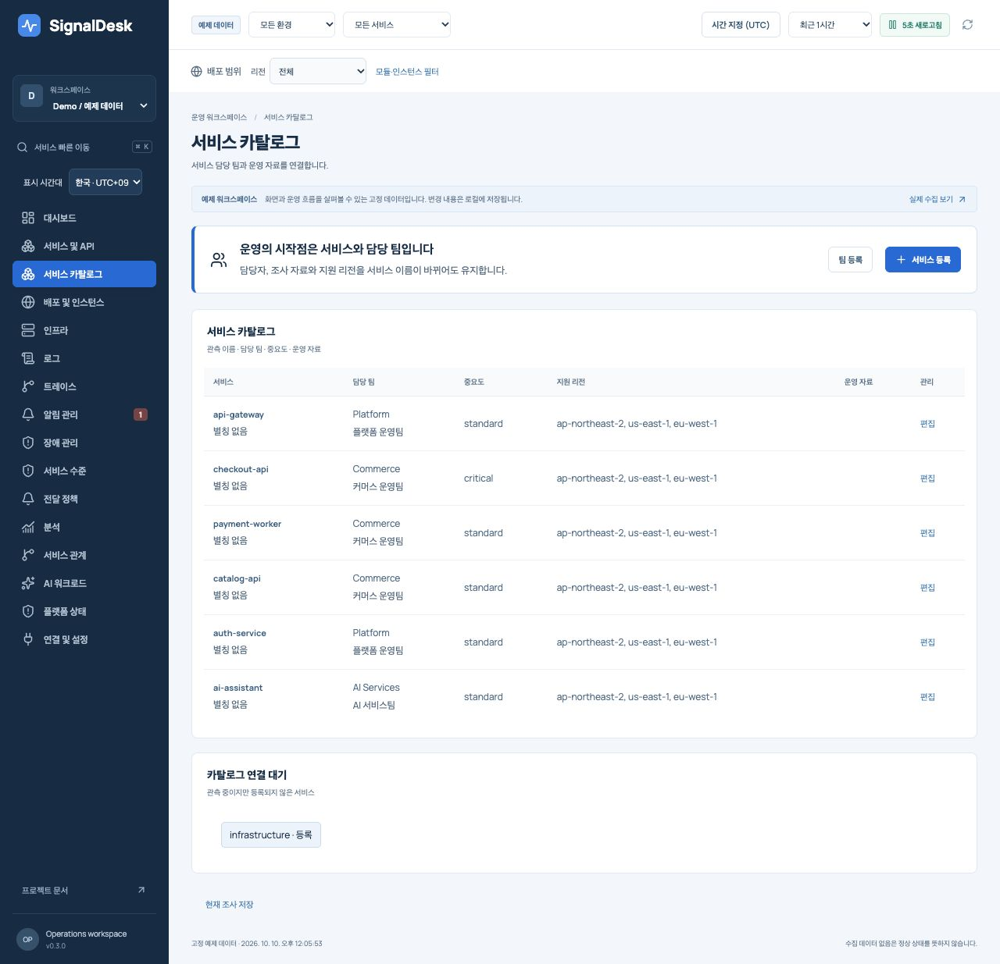
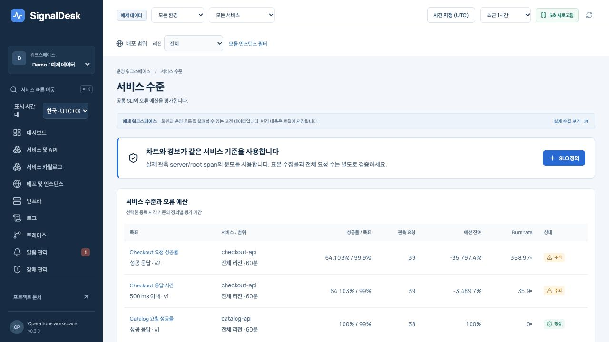
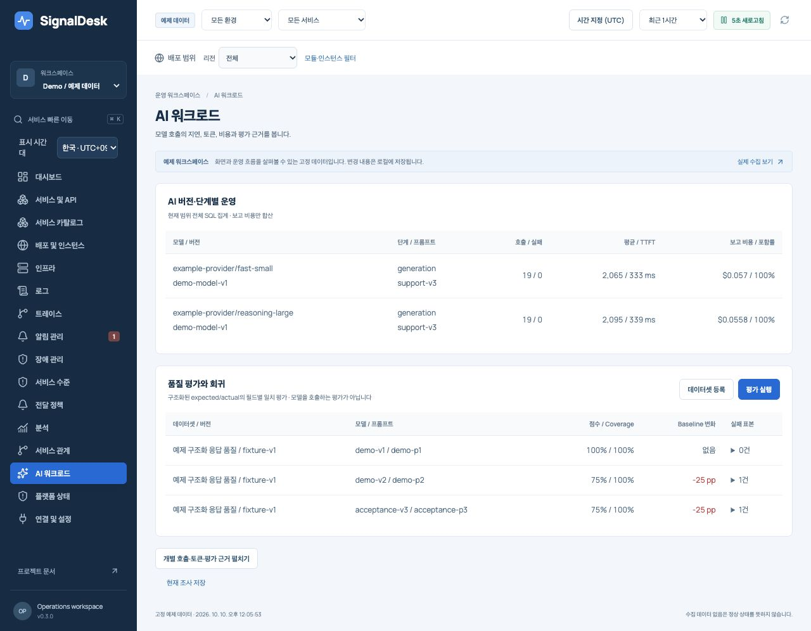
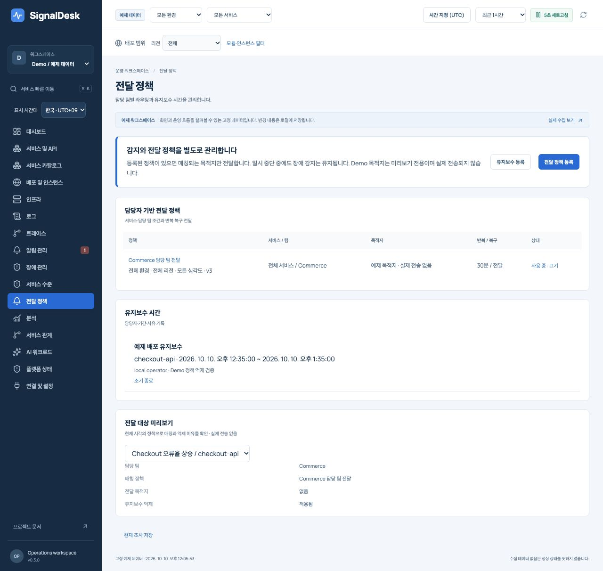
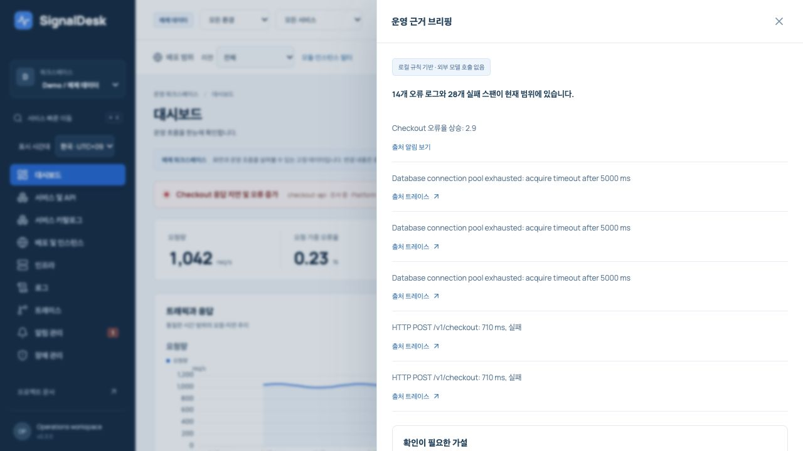

# SignalDesk v0.3 재설계와 개발 수용 기준

2026-10-10. 당근·토스 리서치의 후속 개발. 구현 상태와 검증 결과는 이 문서와 VERIFICATION에 기록한다.

## 책임과 호출 흐름

리전 수집기 → TelemetryStore → 서버 집계/조사 API → 공유 시간·리소스 상태 → 서비스/API/로그/트레이스 화면.
ControlStore는 서비스/팀 ID, SLO 정의, 목적지 정책, 장애·평가 이력을 보존한다. 규칙 평가는 감지 상태를 변경하고 전달 정책은 별도로 outbox를 작성한다. AI 평가와 분석은 운영 자원을 변경하지 않는다.

## 개발 순서

1. R1–R7 회귀 수정: 전 기간 heatmap, cross-region 이동, host/service 발견, trusted proxy와 health quota, URL back/forward, partial trace, 오류 identity.
2. 조사 화면: 공통 절대 시간, URL 선택 상태, 접힌 고급 필터, linked chart 범위, 읽기 가능한 데이터와 접근 가능한 dialog.
3. 카탈로그: 안정적인 team/service ID, 관측 이름/alias, 담당 팀/runbook/리전, 미지정 서비스.
4. 서버 분석: 전체 retained 범위 SQL 집계, API별 요청/실패/지연, 오류 histogram/group, 관계 provenance와 coverage.
5. 알림 운영: 정책 미리보기, 담당 팀/label route, maintenance, firing/recovery/repeat outbox, 억제 수행자와 사유, 다중 alert 사건.
6. SLI/SLO: 버전 정의와 동일 서버 집계, 성공/지연 기준, 분모/관측 coverage, burn rate와 worker 평가.
7. AI 운영: 버전별 실패/TTFT/비용 coverage, 버전 dataset의 실제 규칙 평가 runner, baseline 회귀, 근거/반증 기반 조사 보조.
8. 확장: 제어/관측 저장 계약 분리, 수집/조회/전송 건강 상태, backend contract와 PostgreSQL 다중 worker 검증, 배포·복구 문서.

## 화면 설계

운영용 밝은 작업면과 짙은 남색 탐색 영역. 상태 매트릭스와 비교 행을 중심으로 정보 밀도를 유지한다. 서비스·환경·리전·시간은 고정 문맥, 나머지 차원은 필요할 때 펼친다. 오른쪽 조사 drawer는 permalink와 뒤로 가기를 지원한다.

- Canvas `#f3f6fa`, surface `#ffffff`, ink `#182c43`, navigation `#172b44`, action `#2869d8`, failure `#c43b4d`.
- Manrope와 OS 한국어 sans-serif. 본문 14px 이상, 숫자 tabular, 중요한 상태는 문자와 색을 함께 사용.
- 차트는 공유된 시간 선택과 숫자 보기. 결측은 0으로 대체하지 않는다. 리전별 p95의 최댓값과 전체 분포 percentile을 구분한다.
- 큰 KPI 카드 대신 영향 서비스/담당/리전과 다음 조사를 드러낸다. 모바일에서는 고급 필터를 접고 주요 행동을 먼저 표시한다.

## 검증 경계

단위 회귀, SQLite/공유 PostgreSQL 계약, build, 실제 브라우저 주요 조사 흐름, container 검증을 수행한다. 실제 외부 알림, 관리형 HA/PITR, 지리적 리전 장애 훈련, 실사용자 UX 성과, 외부 LLM 정확도는 각각 별도 운영 증거가 필요하다. 구현·fixture 통과로 이를 완료 처리하지 않는다.

## 상태

v0.3 구현 완료 범위: R1–R7 수정, 카탈로그/팀, 전 기간 SQL 분석, SLO, 전달 정책/유지보수/반복/복구, 다중 알림 장애, 관계 근거, 버전 AI 평가와 opt-in 분석 gateway, 표준 JSON 로그·메트릭, Node 디스크 큐, 플랫폼 상태. 프론트엔드는 화면별 모듈로 분리했다.

구현 검증은 [VERIFICATION](VERIFICATION.md)을 기준으로 확인한다. 목적별 고용량 저장 엔진, 전체 OTLP, SSO/on-call escalation, Kafka lag 어댑터, chart hover/annotation, 실제 외부 AI 정확도·운영 트래픽·지리적 HA는 후속 수용 기준이다. 이 제한은 [ROADMAP](ROADMAP.md)에 남겨 전체 리서치 방향을 구현 완료로 오인하지 않도록 했다.

