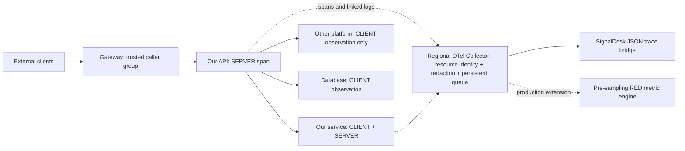

# Instrument caller → API → dependencies

SignalDesk v0.4 separates **incoming requests**, **outgoing attempts** and **final customer responses**. A slow or failed dependency attempt does not by itself establish customer impact or a provider-wide outage. The graph comes from retained spans; absent counterpart spans can mean an uninstrumented service, sampling, ingestion loss or time-window boundaries.

## Recommended deployment



Instrument **our** HTTP server and HTTP client with an official [OpenTelemetry language distribution](https://opentelemetry.io/docs/languages/), e.g. Node auto-instrumentation or the Java agent for Spring applications. Initialize instrumentation before application/framework imports. Add `service.name`, `deployment.environment.name`, `cloud.region`, `signaldesk.module`, `service.instance.id` and applicable cluster/namespace/zone identity. See [OTel HTTP semantics](https://opentelemetry.io/docs/specs/semconv/http/http-spans/).

Set server spans to SERVER (`kind: 2`) and outbound HTTP/database/RPC calls to CLIENT (`kind: 3`). Preserve `traceId`, `spanId` and `parentSpanId`. Use stable `http.route` / `url.template`, `http.request.method`, `http.response.status_code`, `error.type`, `server.address`, `server.port` and `http.request.resend_count`. At an authenticated ingress boundary, set `signaldesk.entry=true` on its SERVER span (or `entry: true` in the manual adapter) when continuing an upstream trace whose root is not recorded here. Never accept that flag from a public caller header. The inspector separates the nearest calling service response from a connected root/marked entry response; missing entry context is unknown. An explicit low-cardinality `peer.service` can name a provider; do not label individual users, request IDs or raw URL paths as routes.

The backend accepts numeric span kinds in its **OTLP/HTTP JSON subset**. Export to the supplied [Collector configuration](../deploy/otel-regional.yaml), which translates transport to JSON/gzip and persists its trace queue. Direct default protobuf exporters are incompatible with this subset. Collector config is tested at contrib **0.162.0**; upstream main's connector rename is not silently applied to this pinned deployment.

## Trust and privacy boundaries

Assign `signaldesk.caller` only in an authenticated gateway/application (for example `partner-api`, `mobile-app`). Do not trust arbitrary public headers or infer caller identity from IP. Continue W3C context only at a configured trust boundary; strip or restart context at a public gateway according to the application security policy. The manual adapter defaults to restarting incoming context and propagates only to exact allowlisted origins. Third parties can be measured without receiving context.

Do not collect authorization, cookies, request/response bodies, baggage, raw URL/query/path or exception messages in the tracing adapter. The supplied Collector uses a fail-closed `transform/privacy` processor to remove known sensitive span-attribute keys **before** its persistent trace queue. [Pinned transform documentation](https://github.com/open-telemetry/opentelemetry-collector-contrib/blob/v0.162.0/processor/transformprocessor/README.md) describes the configuration. Add application-specific Collector/application redaction **before** any persistent regional queue. Backend redaction happens after transport, so it cannot protect secrets already buffered by a differently configured exporter. SignalDesk removes known sensitive attribute keys at ingestion; its durable Node producer also removes them before journal writes. Free-form log messages and arbitrary custom attributes require producer-side review; key-based redaction cannot prove all personal data is absent.

## Run the local example

With SignalDesk running, execute:

```bash
node examples/request-flow.mjs
```

For an alternate local endpoint or token mode, set `SIGNALDESK_URL` and `SIGNALDESK_TOKEN` in your environment. Both services use the same `SIGNALDESK_REGION` (default `ap-northeast-2`); one execution models one independent region. Do not put credentials in URLs or tracked files. The example opens ephemeral loopback listeners, makes 24 real local HTTP customer requests, retries selected simulated provider failures, uploads spans/logs to **Live** under `environment=example`, prints counts and closes its listeners. It never calls a real payment/API/model provider. The provider has no telemetry: its node is deliberately unobserved. These services are explicitly example-labelled.

[SignalDeskTracing](../packages/sdk/tracing.node.js) is an explicit Node adapter, not an auto-instrumentation replacement. It uses AsyncLocalStorage, cryptographic IDs, W3C `traceparent` and monotonic durations. `fetch` measures through response headers, **not response body consumption**; redirects and business retries must be performed explicitly so each origin is checked and each attempt is observed. It does not provide DNS/TLS phase breakdown, automatic retry policy, tail sampling or gRPC instrumentation. Intentional aborts are not classified as errors; timeout/network exceptions are. A propagated sampled flag of zero suppresses span emission.

## Read the investigation

1. Open **요청 흐름**, select Live and `environment=example`.
2. Inspect `example-browser → example-flow-gateway → example-flow-orders → example-provider`.
3. Select the provider connection. Compare outgoing failures/retransmissions with **하위 실패 + API 성공** and **하위 실패 + API 실패**; these are correlated entry responses, not causal proof. Expand the direct calling-service response to compare intermediate success with entry failure.
4. Read route-specific actual observed p50/p95 and latency bins, then open an evidence trace or related service logs. Both internal services stay in the selected region; the external provider's location remains unobserved.
5. Add an error-percentage or p95 **observed-attempt rule**. Minimum observations, evaluation freshness and unknown state are explicit. The Live worker evaluates rules; Demo settings do not trigger network delivery. Existing notification routing, maintenance, acknowledgment, snooze, repeat and recovery apply.

SERVER 4xx is not a server error by default; CLIENT 4xx is a failed dependency attempt. Explicit error status can override either. 429 and timeouts are separately counted. Retransmission count in the UI means attempts with `resend_count > 0`, not the sum of resend ordinal values; redirects may also contribute. One paired CLIENT/SERVER interaction counts once, using the client's duration. Incoming root/entry SERVER spans and outbound CLIENT spans have different denominators.

## Scaling and completeness

The present implementation performs exact SQL rank percentiles over retained selected spans in SQLite/PostgreSQL. It removes duplicates by trace/span/environment identity, looks for context within 24 hours around the window and follows at most 16 ancestor links to both nearest SERVER and root/marked entry SERVER. Missing entry context is never filled from the nearest successful intermediate service. Scope never crosses workspace/environment; exact trace lookup includes all recorded participating services and modules. Historical or mislabelled multi-region traces remain readable; they do not model the current region-local business calls. Missing context remains unknown. Existing resource selectors apply to originating spans and observed receiving services.

API results are bounded to 1,000 route connections and explicitly report truncation. The visual map shows at most 50 nodes / 60 service-pair connections; the numeric list searches the returned route connections. Map labels show the **maximum route/region p95**, never an average presented as a population percentile. Time bins are at least one minute, targeting at most 48 buckets; empty cells are not filled with zero. Evidence is the top 12 failed/slow attempts, not a representative population sample.

For production traffic, generate unsampled request counters/histograms **before tail sampling**, using [Collector sampling guidance](https://grafana.com/docs/opentelemetry/collector/sampling/tail/). Maintain trace-ID affinity for stateful service-graph/tail processors and measured queue/capacity budgets; see [Collector scaling](https://opentelemetry.io/docs/collector/scaling/). Prometheus/Mimir for metrics and Tempo/ClickHouse for large trace storage are extension targets; these adapters and pre-sampling RED pipelines are not implemented here. Do not extrapolate whole-traffic availability or SLOs from sampled retained traces.

Validate at deployment: instrumentation coverage, exporter loss, W3C continuity across asynchronous work, retry amplification, provider timeout/429 behavior, actual request throughput, SQL plan/concurrency, retention/storage costs and geographic failure recovery. Current fixture and multi-process acceptance evidence is recorded in [verification](VERIFICATION.md).
